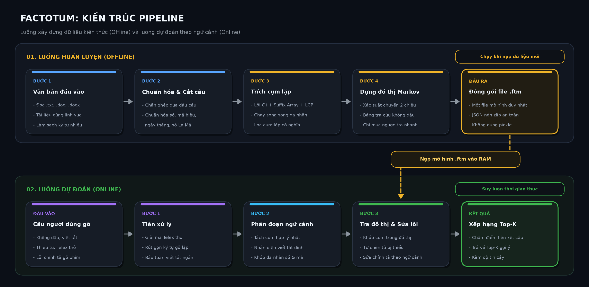
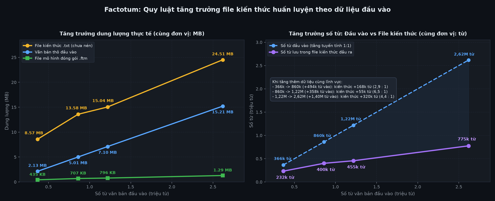

<p align="center">
  
</p>

<h1 align="center">Factotum (<code>factotum-vn-nlp</code>)</h1>

> **Tóm tắt:** Khôi phục tiếng Việt gõ nhanh (không dấu, viết tắt, thiếu từ, lỗi chính tả, Telex) thành câu chuẩn; chạy nhanh, offline trên CPU (Python 3.10+, không cần GPU hay thư viện ngoài) và tự học từ chính tài liệu của bạn.

## Factotum làm được gì?

Factotum chuẩn hóa nhanh câu nhập tiếng Việt gõ tắt, gõ thiếu hoặc gõ lỗi trên CPU. Điểm chính là khả năng tự suy ra từ viết tắt theo ngữ cảnh, sửa lỗi chính tả có dấu mà vẫn giữ nguyên các từ đúng, và lọc bỏ các dự đoán kết thúc cụt lủn:

| Tác vụ | Đầu vào | Kết quả |
| :--- | :--- | :--- |
| Khôi phục dấu tiếng Việt | `xu phat vi pham hanh chinh` | `xử phạt vi phạm hành chính` |
| Khôi phục viết tắt theo chữ cái đầu | `xpvphc atgt` | `xử phạt vi phạm hành chính an toàn giao thông` |
| Tự suy viết tắt theo ngữ cảnh | `quyền sử dd`, `tòa án nd tối cao`, `nd 23/24 quy định điều gì` | `quyền sử dụng đất`, `tòa án nhân dân tối cao`, `nghị định 23/24 quy định điều gì` |
| Đoán từ bị thiếu ở giữa | `an toan thong` | `an toàn giao thông` |
| Giải mã Telex thô & ký tự lặp | `buowcs`, `vi pham phappp luat` | `bước`, `vi phạm pháp luật` |
| Sửa chính tả (OOV & đồng âm) trên câu có dấu | `uống dượu bia phạt bao nhiêu`, `quy định sử lý vi phạm hành chính` | `uống rượu bia phạt bao nhiêu`, `quy định xử lý vi phạm hành chính` |
| Bảo toàn câu đúng & chặn câu cụt lủn | `chạy xe vượt đèn đỏ bị phạt bao nhiêu tiền`, `bộ tư pháp cho` | Giữ nguyên câu đúng; trả gốc kèm `is_fallback=True` khi kết thúc cụt lủn |

### Ví dụ xử lý theo ngữ cảnh

Cùng một chuỗi nhập nhưng đứng trong ngữ cảnh khác nhau sẽ cho ra kết quả khác nhau (chạy trực tiếp trên `output/factotum_law.ftm`):

| Dạng lỗi | Câu nhập | Kết quả |
| :--- | :--- | :--- |
| Viết tắt (`nd`) | `nd 23/24 quy định điều gì` | `nghị định 23/24 quy định điều gì` (`92%`) |
| Viết tắt (`nd`) | `tòa án nd tối cao` | `tòa án nhân dân tối cao` (`99%`) |
| Không dấu (`co the`) | `co the bị xử phạt` | `có thể bị xử phạt` (`99%`) |
| Không dấu (`co the`) | `xâm phạm co the người khác` | `xâm phạm cơ thể người khác` (`94%`) |
| Thiếu từ | `an toan thong` | `an toàn giao thông` (`76%`) |
| Sai chính tả & lặp phím | `sử lý` / `luta pháp` / `vi pham phappp luat` | `xử lý` (`88%`) / `luật pháp` (`72%`) / `vi phạm pháp luật` (`99%`) |

### Phạm vi sử dụng và vị trí trong hệ thống

Factotum không dùng Deep Learning hay GPU. Mô hình dựng đồ thị thống kê từ các cụm lặp trong văn bản (Suffix Array + Maximal Repeats + xác suất chuyển tiếp Markov) và đóng vai trò tầng chuẩn hóa đầu vào đứng trước công cụ tìm kiếm hoặc hệ thống hỏi đáp chuyên ngành:

```text
Người dùng gõ: "nd 23/24 quy định điều gì"
       ↓
  [ Factotum ]        Chuẩn hóa đầu vào (~1–2 ms trên CPU)
       ↓
"nghị định 23/24 quy định điều gì"
       ↓
  [ BM25 + Vector Search ] → [ Reranking ] → Văn bản phù hợp
```

Factotum chạy tốt nhất trên một trường chủ đề hẹp có thuật ngữ lặp lại ổn định (pháp luật, y tế, kế toán, quy trình hành chính, tài liệu nội bộ), không phù hợp cho văn bản mở đa chủ đề hay ngôn ngữ mạng xã hội.

Ưu điểm chính:
- Chạy trên 1 nhân CPU, không phụ thuộc thư viện ngoài (Python 3.10+).
- File phân phối `.ftm` gọn (`1,29 MB` trên đĩa, JSON nén `zlib`, không dùng `pickle`), chiếm khoảng `147 MB` RAM khi nạp và khoảng `197 MB` sau khi ấm bộ đệm cho `113.107` cụm.
- Tốc độ trung bình `1,50 – 2,28 ms/câu` (`P50 = 1,02 – 1,24 ms`, `439 – 665 câu/giây` trên 1 nhân CPU); tự huấn luyện trên `2,62 triệu từ` mất `32,1 giây` với lõi C++ đa nhân.
- Tách bạch 2 pha **Tạo đáp án thuần** (`search.py`, `context.py`) và **Hậu kiểm trên cả câu** (`reviewer.py`): bảo toàn nguyên vẹn câu có dấu đúng chính tả (`20/20`), đồng thời dùng file thô [output/dangling_end_words.txt](output/dangling_end_words.txt) để người dùng tự tùy chỉnh danh sách từ không được đứng cuối câu dự đoán.

Hạn chế:
- Phụ thuộc độ phủ dữ liệu huấn luyện: thuật ngữ hiếm hoặc từ hoàn toàn mới dễ bị kéo về cụm phổ biến hơn.
- Chưa đọc hiểu ngữ nghĩa ở cấp độ cả đoạn văn dài.

## Cài đặt và sử dụng

Yêu cầu Python 3.10+. Không cần cài thêm gói ngoài: `fit_folder()` tự đọc `.docx` qua `zipfile` + `xml.etree.ElementTree` và `.doc` (Word 97–2003) qua bộ giải mã OLE2 Piece Table viết bằng `struct` trong thư viện chuẩn.

### 1. Cài đặt

```bash
cd Factotum
pip install -e .
```

Trên Windows, repo có sẵn `src/factotum/builder/native/sa_lcp.dll` (trích xuất `2,62 triệu từ` mất `5,86 giây`, trọn gói `fit()` mất `32,1 giây`). Trên Linux/macOS, nếu chưa biên dịch thư viện động thì code tự lùi về Python thuần (`~93,5 giây` cho bước trích xuất). Để bật bản C++:

```bash
# Linux
g++ -O3 -std=c++17 -shared -fPIC src/factotum/builder/native/sa_lcp.cpp -o src/factotum/builder/native/libsa_lcp.so

# macOS
g++ -O3 -std=c++17 -shared -fPIC src/factotum/builder/native/sa_lcp.cpp -o src/factotum/builder/native/libsa_lcp.dylib
```

### 2. Dùng mô hình có sẵn (`.ftm`)

File `output/factotum_law.ftm` (`1,29 MB`) nằm sẵn trong repo, huấn luyện từ 156 văn bản quy phạm pháp luật công khai (nguồn VBPL).

```python
from factotum import Factotum

model = Factotum.load("output/factotum_law.ftm")

print(model.restore("xpvphc atgt"))               # xử phạt vi phạm hành chính an toàn giao thông
print(model.restore("nd 23/24 quy định điều gì")) # nghị định 23/24 quy định điều gì
print(model.restore("tòa án nd tối cao"))         # tòa án nhân dân tối cao
print(model.restore("vi pham phappp luat"))       # vi phạm pháp luật

for item in model.predict("quyền sử dd", top_k=3):
    print(f"{item.phrase} (conf={item.confidence:.0%}, fallback={item.is_fallback})")
```

Nếu dự đoán bị kết thúc cụt lủn bởi từ trong [output/dangling_end_words.txt](output/dangling_end_words.txt) (`cho`, `về`, `thì`, `và`...) và không còn phương án trọn nghĩa nào khác, Factotum trả về nguyên văn câu người dùng nhập kèm `item.is_fallback = True` và `item.confidence = 0.0`. File `.txt` này chỉ chứa danh sách từ thô để bạn tự thêm/bớt bất kỳ lúc nào (tự nạp lại sau 2 giây).

### 3. Tự huấn luyện trên dữ liệu riêng

```python
from factotum import Factotum

# Cách 1: Từ danh sách chuỗi văn bản
model = Factotum().fit([
    "hợp đồng mua bán hàng hóa và hợp đồng mua bán dịch vụ.",
    "quyền và nghĩa vụ của các bên trong hợp đồng mua bán hàng hóa.",
])

# Cách 2: Từ thư mục chứa file .txt, .doc, .docx
# model = Factotum().fit_folder("path/to/your_docs")

model.save("my_domain.ftm")
```

### 4. Chạy CLI, Unit Test và Benchmark

```bash
python src/app.py                              # Giao diện dòng lệnh tương tác
python -m unittest discover -s tests -v        # Chạy 23 test (16 unit đa miền + 6 hồi quy mô hình luật + 1 cổng held-out tùy chọn)
FACTOTUM_RUN_HELDOUT_GATE=1 python -m unittest discover -s tests -v  # Bật thêm cổng held-out 124/32 văn bản (cần thư mục data/)
python benchmark/run_benchmark.py 10000        # Tái lập toàn bộ benchmark (seed=42)
```

## Pipeline hoạt động

Factotum gồm 2 luồng tách biệt: luồng huấn luyện (chạy khi nạp tài liệu mới) và luồng dự đoán (chạy trực tiếp trên RAM).



- Luồng huấn luyện đọc tài liệu cùng lĩnh vực, cắt câu để không ghép nhầm qua dấu câu, trích xuất cụm lặp bằng lõi C++ (tự lùi về Python nếu chưa biên dịch), dựng đồ thị xác suất chuyển tiếp 2 chiều và nén thành file `.ftm`.
- Luồng dự đoán tách 2 pha: pha sinh xử lý Telex thô và ký tự lặp, phân đoạn ngữ cảnh, tra đồ thị để khớp cụm, chèn từ thiếu hoặc sửa lỗi chính tả, xếp hạng Top-K kèm `confidence`; pha hậu kiểm (`reviewer.py`) kiểm tra lại toàn bộ câu đáp án theo `output/dangling_end_words.txt` và trả về câu gốc (`is_fallback=True`) nếu không còn phương án hợp lệ.

### Cấu trúc dữ liệu bên trong & thuật ngữ lõi


| Thuật ngữ | Giải thích ngắn |
| :--- | :--- |
| **Suffix Array & LCP** | Sắp xếp mọi hậu tố của văn bản theo thứ tự từ điển kèm độ dài tiền tố chung dài nhất (Longest Common Prefix), giúp tìm toàn bộ cụm lặp trong hàng triệu từ chỉ trong vài giây. |
| **Maximal Repeats (Cụm lặp tối đại)** | Cụm từ xuất hiện lặp lại và không thể mở rộng thêm về bên trái hay bên phải mà vẫn giữ nguyên tần suất (ví dụ `xử phạt vi phạm hành chính`). Đây là cách mô hình tự rút thuật ngữ chuyên ngành mà không cần từ điển gán nhãn sẵn. |
| **Đồ thị chuyển tiếp Markov (2 chiều)** | Lưu xác suất một từ đứng ngay sau (`A → B`) hoặc đứng ngay trước (`B ← A`) một từ khác, dùng để ghép cụm không dấu mới và chèn từ bị thiếu ở giữa. |
| **Bảng tra cứu không dấu (cấp từ đơn)** | Bảng băm ánh xạ từng khóa từ đơn (1 ký tự đầu như `d`, `b`; 2 ký tự đầu+cuối như `dc`, `bc`; hoặc từ không dấu đầy đủ như `co`, `ban`) sang danh sách âm tiết có dấu xếp theo tần suất giảm dần trong $O(1)$. |
| **OOV (Out-of-Vocabulary)** | Từ hoàn toàn mới chưa từng xuất hiện trong tập văn bản huấn luyện. |
| **ECE (Expected Calibration Error)** | Sai số trung bình (%) giữa điểm `confidence` mô hình báo ra và tỷ lệ đúng thực tế; ECE càng nhỏ thì `confidence` càng sát xác suất thật. |

## Benchmark

### Đọc các chỉ số Top-1, Top-3 và Phrase validity

Với câu không dấu đầy đủ (`xu phat vi pham hanh chinh`), đáp án gần như duy nhất nên chấm **Top-1** là đủ. Với viết tắt hoặc thiếu từ, một chuỗi ngắn có nhiều trường hợp hợp lệ khác nhau trong cùng lĩnh vực pháp luật; chấm cứng Top-1 sẽ tính các đáp án hợp lệ khác là sai:

| Câu nhập | Đáp án gốc trong test | Gợi ý Top-1 của Factotum | Chấm Top-1 | Nhận xét |
| :--- | :--- | :--- | :---: | :--- |
| `cnt` | `cho nhà thầu` | `của nhà thầu` | Sai | Cụm hợp lệ trong ngữ liệu |
| `tth` | `trừ trường hợp` | `trong trường hợp` | Sai | Cụm hợp lệ trong ngữ liệu |
| `cgt` | `cho gói thầu` | `của gói thầu` | Sai | Cụm hợp lệ trong ngữ liệu |
| `nvld` | `nghĩa vụ lao động` | `nghĩa vụ liên đới` | Sai | Cụm hợp lệ trong ngữ liệu |

Do đó các bảng bên dưới báo cáo song song **Top-1**, **Top-3** và **Phrase validity** (tỷ lệ toàn bộ cụm gợi ý số 1 xuất hiện nguyên vẹn trong ngữ liệu, chặt hơn kiểm tra từng cặp 2 từ riêng lẻ).


### 1. Document-level Held-out (124 văn bản học / 32 văn bản mới, 10.000 câu)

Tách hoàn toàn theo đơn vị file (`seed = 42`, tập kiểm tra rút các cụm trọn nghĩa không cụt lủn từ 32 văn bản chưa từng học: `4.000` câu không dấu, `2.000` viết tắt hỗn hợp, `2.000` thiếu từ, `2.000` viết tắt toàn cụm). Đối chiếu với `Base-1g` (Unigram 3-best) và `Base-2g` (Bigram + Viterbi 3-best) dùng chung từ điển và xác suất chuyển:

| Nhóm câu hỏi | Số câu | Base-1g (`T1 / T3 / Phrase`) | Base-2g (`T1 / T3 / Phrase`) | Factotum (`T1 / T3 / Phrase`) |
| :--- | :---: | :---: | :---: | :---: |
| Không dấu đã có trong tập học | 952 | 56,6 / 81,0 / 58,3% (`0,08 ms`) | 99,2 / 100,0 / 99,7% (`0,10 ms`) | **99,9 / 100,0 / 100,0%** (`1,15 ms`) |
| Không dấu mới hoàn toàn | 3.048 | 41,8 / 67,5 / 43,0% (`0,08 ms`) | **89,8 / 97,6 / 90,8%** (`0,11 ms`) | 87,2 / 96,7 / 90,8% (`1,63 ms`) |
| Viết tắt hỗn hợp | 2.000 | 10,6 / 21,9 / 15,6% (`0,08 ms`) | 59,5 / 76,0 / 70,2% (`0,36 ms`) | **68,5 / 79,8 / 80,0%** (`2,90 ms`) |
| Thiếu 1 từ ở giữa | 2.000 | 0,0 / 0,0 / 25,1% (`0,06 ms`) | 0,0 / 0,0 / 32,1% (`0,07 ms`) | **35,4 / 48,4 / 62,6%** (`1,33 ms`) |
| Viết tắt toàn cụm | 2.000 | 0,5 / 1,3 / 4,8% (`0,08 ms`) | 15,8 / 26,1 / 48,5% (`10,98 ms`) | **25,7 / 32,9 / 91,8%** (**`4,12 ms`**) |
| **Tổng (bỏ nhóm thiếu từ)** | **8.000** | **25,4 / 41,2 / 28,4%** | **64,9 / 74,6 / 76,1%** | **68,7 / 76,9 / 89,5%** |
| **Tổng cộng (tất cả)** | **10.000** | **20,3 / 32,9 / 27,8%** (`0,07 ms`) | **51,9 / 59,7 / 67,3%** (`2,33 ms`) | **62,0 / 71,2 / 84,1%** (**`2,28 ms`**, `P50 = 1,24 ms`) |

Hai baseline đạt `0%` Top-1/Top-3 ở nhóm thiếu từ vì không có cơ chế chèn từ. Khi bỏ nhóm này (`8.000` câu), Factotum hơn `Base-2g` `+3,8%` Top-1 (`68,7%` vs `64,9%`) và `+13,4%` Phrase validity (`89,5%` vs `76,1%`). Riêng ở nhóm không dấu mới hoàn toàn (`3.048` câu), `Base-2g` cao hơn Factotum `2,6%` Top-1 (`89,8%` vs `87,2%`) và nhanh hơn.

Trên bộ **Stress Test 10.000 câu** (in-sample), Factotum đạt **`90,8%` Top-1 / `98,0%` Top-3 / `99,9%` LV** (`1,50 ms/câu`, `P50 = 1,02 ms`, `665 câu/s`, vượt `Base-2g` `+20,6%` Top-1). Bộ hồi quy thủ công đạt **`60/60` (`100%`)**, bộ bảo toàn câu hỏi có dấu chuẩn đạt **`20/20` (`100%`)**. Chi tiết xem tại [benchmark/README.md](benchmark/README.md) và danh sách `4.721` câu lệch Top-1 tại `benchmark/failures.csv`.

### 2. Độ tin cậy (`confidence`) & Ablation Study (10.000 câu Document-level Held-out)


| Mức `confidence` | Số câu | `confidence` TB | Đúng Top-1 | Đúng Top-3 | Phrase validity |
| :---: | :---: | :---: | :---: | :---: | :---: |
| `90 – 100%` | 3.857 | 95,3% | 67,2% | 75,1% | **99,5%** |
| `70 – 90%` | 2.109 | 80,4% | 71,6% | 80,0% | **93,5%** |
| `50 – 70%` | 1.966 | 57,7% | 65,3% | 75,7% | **79,3%** |
| `30 – 50%` | 1.358 | 44,4% | 49,3% | 61,3% | **62,9%** |
| `< 30%` | 710 | 9,7% | 20,7% | 30,8% | **26,5%** |

Với ngưỡng `confidence >= 70%` (`5.966/10.000` câu), Phrase validity đạt `93,5% – 99,5%` nên có thể tự áp dụng hoặc ưu tiên hiển thị; mức `50–70%` (`79,3%`) phù hợp hiển thị dạng gợi ý; mức `< 30%` (`26,5%`) hoặc `is_fallback = True` nên giữ nguyên câu gốc. Sai số hiệu chuẩn hiện tại: `ECE (Phrase validity) = 12,3%`, `ECE (Top-1) = 15,6%`.

Ablation Study trên cùng 10.000 câu:

| Cấu hình | Top-1 | Phrase validity | Ghi chú |
| :--- | :---: | :---: | :--- |
| Chỉ Maximal Repeats (bỏ đồ thị Markov) | `17,7%` | `30,6%` | Khớp cụm đã học (`99,9%`), `0%` cụm mới và thiếu từ. |
| Chỉ Đồ thị Bigram (`Base-2g`, bỏ Maximal Repeats) | `51,9%` | `67,3%` | Tốt ở không dấu mới (`89,8%`), yếu ở viết tắt (`48,5%` PV) và `0%` thiếu từ. |
| **Factotum đầy đủ (Maximal Repeats + Đồ thị + Chèn từ)** | **`62,0%`** | **`84,1%`** | Giữ cụm trọn nghĩa ở viết tắt và ghép cụm mới/chèn từ bằng đồ thị. |

### 3. Đối đầu trực tiếp với LLM (Held-out, zero-shot)

Rút `1.000` câu độc nhất từ 32 văn bản kiểm tra chưa từng học (`seed = 42`, chia đều 4 nhóm: không dấu mới, viết tắt hỗn hợp, thiếu 1 từ và viết tắt toàn cụm), lọc còn **`919` cụm trọn nghĩa** (bỏ `81` cửa sổ bị cắt cụt lủn theo `output/dangling_end_words.txt`). Hai LLM lớn chạy ở chế độ zero-shot trên cùng một prompt có quy tắc giữ đúng độ dài cụm (cả hai trả lời đủ `1.000/1.000` câu và tuân thủ đúng quy tắc):

| Nhóm câu hỏi | Số câu | Factotum (`T1 / PV`) | Gemini Hydrogen, zero-shot (`T1 / PV`) | Claude Sonnet 5.5, zero-shot (`T1 / PV`) |
| :--- | :---: | :---: | :---: | :---: |
| Không dấu mới hoàn toàn | 231 | **85,7% / 91,3%** (`96,1%` T3) | **85,7%** / 87,9% | 79,7% / 81,8% |
| Viết tắt hỗn hợp | 228 | 64,9% / **79,4%** (`78,5%` T3) | 64,0% / 78,1% | **65,8%** / 78,9% |
| Thiếu 1 từ ở giữa | 234 | **36,8% / 67,5%** (`48,7%` T3) | 33,3% / 59,0% | **36,8%** / 51,7% |
| Viết tắt toàn cụm | 226 | **23,5% / 89,4%** (`31,9%` T3) | 6,6% / 43,8% | 2,2% / 29,6% |
| **Tổng cộng (cụm trọn nghĩa)** | **919** | **52,8% / 81,8%** (`63,9%` T3) | **47,6% / 67,2%** | **46,2% / 60,6%** |
| **Thời gian chạy 1.000 câu** | | **`3,35 giây`** (1 CPU offline, `1,29 MB`) | `~15 giây` (batch cloud) | `~20 phút` (cloud) |

*Lưu ý công bằng:* tính trên cả `1.000` câu thô (gồm `81` câu cụt lủn mà tầng hậu kiểm của Factotum chủ động trả về câu gốc), Factotum vẫn dẫn đầu với `48,5%` Top-1 / `77,5%` PV so với Gemini (`46,4% / 66,3%`) và Claude (`45,4% / 60,2%`). Hai LLM chạy zero-shot (không RAG, không fine-tune trên 124 văn bản luật), trong khi Factotum đã học trực tiếp phân phối cụm từ của lĩnh vực pháp luật. Ở nhóm viết tắt hỗn hợp, Claude Sonnet 5.5 nhỉnh hơn `+0,9%` Top-1 (`65,8%` vs `64,9%`); ngược lại ở nhóm viết tắt toàn cụm chuyên ngành, Factotum đạt `23,5%` Top-1 và `89,4%` Phrase validity (so với `6,6% / 43,8%` của Gemini và `2,2% / 29,6%` của Claude) với chi phí tính toán nhỏ hơn nhiều lần.

### 4. Giới hạn của bộ đo

- Các nghị định pháp luật thường trích dẫn và dùng lại nhiều mẫu câu hành chính giống nhau, nên tách theo file vẫn có thể còn trùng lặp nội dung một phần. Chưa có phép thử tách theo năm ban hành, theo loại văn bản hoặc cross-domain (học luật, kiểm tra kế toán/y tế).
- Toàn bộ câu kiểm tra được sinh tự động từ ngữ liệu và đã lọc OOV (chưa có tập log gõ thật của người dùng). `Phrase validity` chỉ kiểm tra nguyên cụm có tồn tại trong ngữ liệu, chưa thay thế đánh giá ngữ nghĩa thủ công.

## Tỷ lệ tăng trưởng dữ liệu theo văn bản đầu vào



| Số văn bản | Số từ đầu vào (`N`) | Dung lượng văn bản thô | File kiến thức `.txt` (chưa nén) | Số từ lưu trong cụm kiến thức | File mô hình đóng gói `.ftm` |
| :---: | :---: | :---: | :---: | :---: | :---: |
| 10 | 365.615 từ | 2,13 MB | 8,57 MB (**402%**) | 232.179 từ (**63,5%**) | 434,9 KB (**20,0%**) |
| 30 | 860.123 từ | 5,01 MB | 13,58 MB (**271%**) | 400.387 từ (**46,5%**) | 707,4 KB (**13,8%**) |
| 80 | 1.218.295 từ | 7,10 MB | 15,04 MB (**212%**) | 455.391 từ (**37,4%**) | 796,4 KB (**11,0%**) |
| 156 | 2.618.007 từ | 15,21 MB | 24,51 MB (**161%**) | 775.032 từ (**29,6%**) | 1,29 MB (**8,5%**, nén `11,8 : 1`) |

Hồi quy log-log ($\log S = a + \alpha \log N$) trên 4 mốc với $N$ là tổng số từ đầu vào:
- File `.txt` chưa nén: $S_{\text{txt}} \propto N^{0.53}$
- File đóng gói `.ftm`: $S_{\text{ftm}} \propto N^{0.56}$
- Số từ lưu trong cụm kiến thức: $S_{\text{words}} \propto N^{0.60}$

## Quá trình cải tiến qua các phiên bản


## So sánh với các hướng tiếp cận khác

Số liệu `Base-1g`, `Base-2g` và `Factotum` lấy từ Document-level Held-out 10.000 câu; cột `LLM (zero-shot)` tham chiếu kết quả đo trực tiếp trên `919` cụm trọn nghĩa ở mục 3; cột `SymSpell` là mức tham khảo định tính:

| Tiêu chí | `Base-1g` (Unigram) | `Base-2g` (Bigram + Viterbi) | Factotum | SymSpell / Edit Distance* | LLM (zero-shot) |
| :--- | :---: | :---: | :---: | :---: | :---: |
| Khôi phục dấu (cụm mới) | `41,8%` Top-1 | **`89,8%`** Top-1 (`97,6%` Top-3) | `87,2%` Top-1 (`96,7%` Top-3) | Không hỗ trợ | `79,7% – 85,7%` Top-1 (mục 3) |
| Khôi phục viết tắt toàn cụm | `0,5%` Top-1 (`4,8%` PV) | `15,8%` Top-1 (`48,5%` PV) | **`25,7%`** Top-1 (**`91,8%`** PV) | Không | `2,2% – 6,6%` Top-1 (`29,6% – 43,8%` PV) |
| Đoán từ bị thiếu ở giữa | `0%` | `0%` | `35,4%` Top-1 (`62,6%` PV) | Không | `33,3% – 36,8%` Top-1 (`51,7% – 59,0%` PV) |
| Sửa lỗi chính tả & Telex thô | Không | Không | Hỗ trợ OOV & đồng âm, giữ nguyên câu đúng | Tốt (từng từ đơn) | Tốt |
| Tự huấn luyện trên dữ liệu riêng | Nhanh | Nhanh | `~32 giây` (CPU + C++) / `~105 giây` (Python thuần) | Nhanh | Chậm, thường cần GPU |
| Dung lượng (Đĩa / RAM) | Vài MB | Vài MB | `1,29 MB` đĩa / `~147–197 MB` RAM | Rất nhỏ | `400 MB` – hàng chục GB* |
| Tốc độ suy luận | `0,07 ms/câu` (CPU) | `2,33 ms/câu` (CPU) | `1,50 – 2,28 ms/câu` (CPU offline) | `< 1 ms/câu`* | `~15 ms` (batch) – `1,2 s/câu` (cloud) |
| Hiểu ngữ nghĩa mở đa lĩnh vực | Không | Không | Không | Không | Cao |

*\*Khoảng tham khảo tùy kiến trúc mô hình, mức lượng tử hóa và phần cứng.*

## Giấy phép

MIT License.
