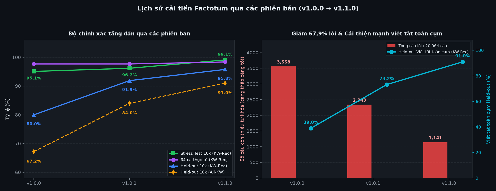

<p align="center">
  
</p>

<h1 align="center">Factotum</h1>

<p align="center">
  <strong>Làm rõ ngữ cảnh và thực thể cho tiếng Việt gõ nhanh, viết tắt, bỏ dấu, thiếu từ — chạy cục bộ, gọn nhẹ và không cần GPU.</strong>
</p>

<p align="center">
  <a href="https://huggingface.co/spaces/evilogre1112/factotum"></a>
  
  
  
  
  
</p>

<p align="center">
  <strong>Tiếng Việt</strong> | <a href="README.en.md">English</a>
</p>

> **Dùng thử trực tuyến:** mở **[Demo trên Hugging Face Spaces](https://huggingface.co/spaces/evilogre1112/factotum)** để trải nghiệm nhanh không cần cài đặt.

---

## Bạn gõ vội — Factotum làm rõ ngữ cảnh

Hằng ngày người dùng thường gõ tắt (`tngt`, `atgt`, `csgt`, `xpvphc`, `nd`), bỏ dấu (`xu phat vi pham`), rớt chữ (`an toan thong`) hoặc gõ lỗi Telex (`buowcs`, `phappp`). Những câu viết tắt rời rạc này dễ khiến thanh tìm kiếm, hệ thống gợi ý hay công cụ trích xuất thông tin hiểu nhầm hoặc bỏ sót tài liệu quan trọng.

**Factotum** làm rõ các cụm từ viết tắt, khôi phục dấu, bổ sung từ bị rơi và sửa lỗi chính tả dựa trên đúng ngữ cảnh xung quanh — giúp câu chữ rõ nghĩa hơn cho cả người đọc lẫn các công cụ tìm kiếm phía sau:

| Tình huống thực tế | Bạn gõ | Factotum làm rõ thành |
| :--- | :--- | :--- |
| **Gõ không dấu** | `xu phat vi pham hanh chinh` | `xử phạt vi phạm hành chính` |
| **Nhiều viết tắt dài đứng sát nhau** | `csgt xpvphc người không có gplx` | `cảnh sát giao thông xử phạt vi phạm hành chính người không có giấy phép lái xe` |
| **Giải nhập nhằng viết tắt theo ngữ cảnh** | `nd 23/24 quy định về atgt đường bộ` / `tòa án nd tối cao` | `nghị định 23/24 quy định về an toàn giao thông đường bộ` / `tòa án nhân dân tối cao` |
| **Rơi mất từ ở giữa** | `an toan thong` / `xe k bang lai` | `an toàn giao thông` / `xe không có bằng lái` |
| **Lỗi Telex, lặp phím & sai chính tả** | `buowcs`, `uống dượu bia phạt bao nhiêu`, `hộ kihw doan` | `bước`, `uống rượu bia phạt bao nhiêu`, `hộ kinh doanh` |
| **Giữ nguyên câu đã gõ đúng** | `chạy xe vượt đèn đỏ bị phạt bao nhiêu tiền` | Giữ nguyên không sửa bừa |

---

## Điểm nổi bật của Factotum

- **Tập trung làm rõ ngữ cảnh & thực thể:** Giúp nổi rõ các từ khóa quan trọng ẩn sau chữ viết tắt hoặc bỏ dấu, nhờ đó công cụ tìm kiếm, tìm kiếm ngữ nghĩa (embedding), trích xuất thực thể hay hệ thống gợi ý phía sau hoạt động chính xác hơn.
- **Gọn nhẹ, chạy cục bộ không cần GPU:** Chỉ cần Python 3.10+, không phụ thuộc thư viện ngoài. Toàn bộ kho tri thức sau khi học được đóng gói thành một file `.ftm` nhẹ (~1,3 MB).
- **Chủ động kiểm soát dữ liệu nội bộ:** Khi cài chạy trên máy hoặc máy chủ riêng của bạn, toàn bộ quá trình học tài liệu và xử lý văn bản diễn ra hoàn toàn cục bộ, không cần gửi dữ liệu qua API bên thứ ba.
- **Phản hồi nhanh trong vài mili-giây:** Đủ mượt để gắn trực tiếp vào thanh tìm kiếm hoặc hộp gợi ý ngay trong lúc người dùng đang gõ.
- **Tự học từ chính tài liệu của bạn:** Đưa trực tiếp thư mục file Word (`.doc`, `.docx`) hoặc `.txt` của tổ chức vào — Factotum tự rút ra bộ thuật ngữ chuyên ngành mà không cần gán nhãn thủ công.
- **Minh bạch, dễ kiểm tra:** Không tự bịa nội dung ngoài dữ liệu đã học. Khi câu quá mơ hồ, Factotum ưu tiên giữ nguyên câu gốc thay vì đoán bừa; người dùng có thể mở xem và chỉnh sửa trực tiếp các file tri thức thuần văn bản.

---

## Kết quả Benchmark nổi bật (v1.1.0)

Đánh giá trên **20.064 câu kiểm thử** ([report_10000_20261127_201343.txt](benchmark/report_10000_20261127_201343.txt)):

| Bộ kiểm thử | Quy mô | Câu gốc (`KW-Rec`) | Base-2g (`KW-Rec`) | **Factotum v1.1 (`KW-Rec` / `All-KW` / `Ctx-F1`)** | Trung vị tốc độ |
| :--- | :---: | :---: | :---: | :---: | :---: |
| **Văn bản chưa từng học (Held-out)** | 10.000 câu | 19,5% | 87,3% | **95,8% / 91,0% / 96,2%** | `3,15 ms` |
| **64 ca thực tế có từ khóa bắt buộc** | 64 câu | 23,4% | 64,3% | **98,4% / 96,9% / 99,7%** | `12,33 ms` |
| **Kiểm thử tải trên thuật ngữ đã học** | 10.000 câu | 16,9% | 91,1% | **99,1% / 97,6% / 99,2%** | `2,22 ms` |



---

## Các trường hợp ứng dụng thực tế & Cách áp dụng

Factotum phù hợp nhất khi đứng làm **lớp làm rõ văn bản đầu vào** cho các lĩnh vực có bộ thuật ngữ lặp lại ổn định:

```text
Người dùng gõ nhanh: "csgt xpvphc người không có gplx"
           ↓
      [ Factotum ]        Làm rõ ngữ cảnh & thực thể trong vài mili-giây
           ↓
"cảnh sát giao thông xử phạt vi phạm hành chính người không có giấy phép lái xe"
           ↓
[ Tìm kiếm / Embedding & RAG / Trích xuất thực thể / Gợi ý ] → Kết quả chính xác hơn
```

| Lĩnh vực áp dụng | Bài toán thực tế | Cách áp dụng Factotum |
| :--- | :--- | :--- |
| **Tìm kiếm tài liệu & Embedding / RAG** | Câu hỏi gõ tắt (`nd 23/24`, `xpvphc`, `gplx`) khiến hệ thống tìm kiếm hoặc mô hình embedding khó khớp đúng văn bản gốc. | Đặt `model.restore(query)` ngay trước bước tìm kiếm hoặc tạo vector để làm rõ toàn bộ từ khóa trong câu hỏi. |
| **Pháp lý – Hành chính công** | Chuyên viên, người dân tra cứu luật hay gõ tắt `tngt`, `atgt`, `xpvphc`, `tòa án nd tối cao`. | Dùng ngay file `output/factotum_law.ftm` có sẵn đặt trước ô tra cứu văn bản luật hoặc công cụ tốc ký. |
| **Y tế – Bệnh án – Dược** | Bác sĩ, điều dưỡng ghi chú nhanh tên thuốc, chẩn đoán viết tắt và cần giữ dữ liệu nội bộ. | Chạy `fit_folder()` trên kho bệnh án mẫu / danh mục thuốc nội bộ (`.docx`/`.txt`) để tạo file `.ftm` chạy ngay trong mạng nội bộ. |
| **CSKH – Live Chat – Gợi ý ý định** | Khách hàng nhắn không dấu, rơi chữ, sai chính tả khiến hệ thống FAQ hoặc phân loại ý định dễ bắt nhầm. | Gắn Factotum trước bước phân loại ý định hoặc trước chatbot để tăng tỷ lệ bắt đúng chủ đề mà không tốn phí gọi API cho từng tin nhắn. |
| **Kế toán – Kho vận – Doanh nghiệp** | Nhân viên nhập liệu biên bản, mã vật tư, quy trình nội bộ với nhiều cụm từ đặc thù của công ty. | Nạp tài liệu quy trình nội bộ để Factotum tự học; khi có tài liệu mới chỉ cần gọi `update_folder()` để bổ sung. |


---

## Bắt đầu nhanh trong 1 phút

### 1. Cài đặt

```bash
git clone https://github.com/evilogre1112/Factotum.git
cd Factotum
pip install -e .
```

### 2. Dùng thử ngay với dữ liệu pháp luật có sẵn

```python
from factotum import Factotum

model = Factotum.load("output/factotum_law.ftm")

print(model.restore("csgt xpvphc người không có gplx"))
# cảnh sát giao thông xử phạt vi phạm hành chính người không có giấy phép lái xe

print(model.restore("nd 23/24 quy định về atgt đường bộ"))
# nghị định 23/24 quy định về an toàn giao thông đường bộ

print(model.restore("tòa án nd tối cao"))  # tòa án nhân dân tối cao
print(model.restore("an toan thong"))      # an toàn giao thông
```

### 3. Tự dạy Factotum học tài liệu của riêng bạn

Factotum đọc trực tiếp file `.txt`, `.docx` và `.doc`:

```python
from factotum import Factotum

# Học từ cả thư mục tài liệu của bạn
model = Factotum().fit_folder("duong_dan/thu_muc_tai_lieu")

# Lưu thành 1 file .ftm nhỏ gọn để mang đi sử dụng
model.save("my_company.ftm")

# Sau này có tài liệu mới, chỉ cần học bổ sung:
# model.update_folder("duong_dan/tai_lieu_moi")
```

### 4. Mở giao diện dùng thử

```bash
python src/app.py                         # Giao diện dòng lệnh (nạp dữ liệu, thử truy vấn, cập nhật tri thức)
pip install gradio && python demo/app.py  # Giao diện web trực quan tại http://127.0.0.1:7860
```

---

## Cấu hình & Tùy chỉnh theo nhu cầu

### 1. Dùng điểm tin cậy (`confidence`) để chọn tự áp dụng hay hiển thị gợi ý

Khi tích hợp vào ứng dụng, bạn có thể lấy nhiều phương án gợi ý kèm mức độ tin cậy (`0% – 100%`) và danh sách các vị trí đã được làm rõ (`edits`):

```python
results = model.predict("csgt xpvphc người không có gplx", top_k=3)
best = results[0]

if not best.is_fallback and best.confidence >= 0.70:
    # Độ tin cậy cao → có thể tự động áp dụng
    text = best.phrase
elif not best.is_fallback and best.confidence >= 0.50:
    # Độ tin cậy trung bình → hiển thị dạng gợi ý cho người dùng chọn
    suggestions = [r.phrase for r in results]
else:
    # Chưa đủ chắc chắn → giữ nguyên câu người dùng nhập
    text = "csgt xpvphc người không có gplx"
```

### 2. Tùy chỉnh danh sách từ không được đứng cuối câu

Mở trực tiếp file [output/dangling_end_words.txt](output/dangling_end_words.txt) để thêm hoặc bớt các hư từ, liên từ (`của`, `cho`, `về`, `thì`, `và`...). Nếu gợi ý kết thúc cụt nghĩa bởi các từ này, Factotum sẽ tự động loại bỏ. Thay đổi có hiệu lực sau khoảng 2 giây mà **không cần huấn luyện lại**.

### 3. Quản lý & Chỉnh sửa kho tri thức

Xem hướng dẫn chi tiết từng file trong thư mục `output/` (file nào chỉnh sửa tự do, file nào nên hạn chế đụng vào) tại **[output/README.md](output/README.md)**.

<details>
<summary><strong>Tùy chọn tăng tốc bước học dữ liệu trên Linux / macOS</strong> (Windows đã có sẵn)</summary>

Trên Windows, bản tăng tốc C++ đã được đóng gói sẵn. Trên Linux/macOS, Factotum vẫn chạy bình thường bằng Python thuần; nếu muốn tăng tốc bước học tài liệu lớn, bạn có thể biên dịch thêm bằng 1 lệnh:

```bash
# Linux
g++ -O3 -std=c++17 -shared -fPIC src/factotum/builder/native/sa_lcp.cpp -o src/factotum/builder/native/libsa_lcp.so

# macOS
g++ -O3 -std=c++17 -shared -fPIC src/factotum/builder/native/sa_lcp.cpp -o src/factotum/builder/native/libsa_lcp.dylib
```

</details>

---

## Điểm yếu & Giới hạn hiện tại

Để bạn cân nhắc đúng trước khi áp dụng vào dự án, dưới đây là các giới hạn thực tế của Factotum:

- **Phụ thuộc vào bộ tài liệu đã học:** Factotum phát huy hiệu quả cao nhất trong đúng lĩnh vực có thuật ngữ lặp lại ổn định mà bạn đã nạp. Từ quá hiếm, từ hoàn toàn mới hoặc ngôn ngữ mạng xã hội / tiếng lóng đa chủ đề có thể bị đoán lệch sang cụm phổ biến hơn.
- **Không hiểu ngữ nghĩa sâu ở cấp độ cả đoạn văn dài:** Factotum không dùng mô hình ngôn ngữ lớn (LLM), nên không thể suy luận ý định phức tạp, tóm tắt hay viết lại câu theo văn phong khác.
- **Hạn chế tự nhiên với viết tắt quá ngắn đứng cô lập:** Một chuỗi 3–4 chữ cái đứng một mình không có ngữ cảnh có thể hợp lệ theo nhiều nghĩa khác nhau (ví dụ `cnt` có thể là `cho nhà thầu` hoặc `của nhà thầu`). Trong trường hợp này nên dùng Factotum kèm ngữ cảnh xung quanh hoặc hiển thị Top-3 gợi ý.
- **Hạn chế khi thiếu nhiều từ liên tiếp hoặc sai chính tả quá nặng:** Cơ chế bổ sung từ hiện tối ưu cho trường hợp rơi 1 từ ở giữa cụm; nếu câu đầu vào vừa thiếu nhiều từ vừa sai chính tả nặng cùng lúc, Factotum sẽ ưu tiên giữ nguyên câu gốc để tránh sửa sai.

---

## Báo cáo Benchmark & Tài liệu chi tiết

Toàn bộ báo cáo kiểm thử, biểu đồ trực quan và hướng dẫn tự chạy benchmark được tách riêng để trang giới thiệu luôn gọn gàng:

- **[Báo cáo Benchmark & Biểu đồ trực quan](benchmark/REPORT.md)** — Kết quả đánh giá trên 20.064 câu kiểm thử, đối đầu trực tiếp với Gemini & Claude, biểu đồ so sánh trực quan, phân tích độ tin cậy và đường cong tăng trưởng dữ liệu.
- **[Phương pháp & Hướng dẫn tự chạy Benchmark](benchmark/README.md)** — Cấu trúc 3 bộ kiểm thử và lệnh tái lập kết quả (`python benchmark/run_benchmark.py 10000`).
- **[Giải thích các file tri thức & Cách tùy chỉnh](output/README.md)** — Chi tiết từng file trong thư mục `output/`.
- **[Hướng dẫn đóng gói Demo Web](demo/README.md)** — Tự triển khai demo trên Hugging Face Spaces hoặc Gradio.
- **[Đóng góp](CONTRIBUTING.md)** • **[Lịch sử phiên bản](CHANGELOG.md)** • **[Trích dẫn (`CITATION.cff`)](CITATION.cff)**

## Giấy phép

MIT License.
