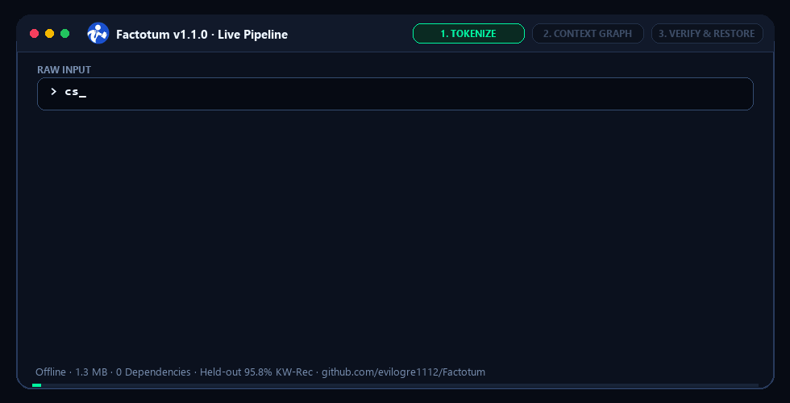

<p align="center">
  
</p>

<h1 align="center">Factotum</h1>

<p align="center">
  <strong>Fast, lightweight, offline context & entity clarification for Vietnamese shorthand, abbreviations, unaccented typing, and missing words — zero GPU required.</strong>
</p>

<p align="center">
  <a href="https://huggingface.co/spaces/evilogre1112/factotum"></a>
  <a href="https://pypi.org/project/factotum-vn-nlp/"></a>
  
  
  
  
  
</p>

<p align="center">
  <strong>🇺🇸 English</strong> | <a href="README.vi.md">🇻🇳 Tiếng Việt</a>
</p>

> **Try it online:** open the **[Hugging Face Spaces Demo](https://huggingface.co/spaces/evilogre1112/factotum)** to test Factotum right in your browser with no setup required.

<p align="center">
  
</p>

---

## You Type Fast — Factotum Clarifies the Context

Every day, users type shorthand (`tngt`, `atgt`, `csgt`, `xpvphc`, `nd`), omit Vietnamese diacritics (`xu phat vi pham`), drop words (`an toan thong`), or make Telex/key-repeat typos (`buowcs`, `phappp`). Fragmented queries like these easily confuse search bars, autocomplete widgets, and entity-extraction pipelines.

**Factotum** expands abbreviations, restores Vietnamese diacritics, recovers dropped words, and fixes typos using surrounding context — making queries clear for both human readers and downstream search engines:

| Real-World Case | What You Type | Factotum Clarifies To |
| :--- | :--- | :--- |
| **Unaccented typing** | `xu phat vi pham hanh chinh` | `xử phạt vi phạm hành chính` |
| **Chained long abbreviations** | `csgt xpvphc người không có gplx` | `cảnh sát giao thông xử phạt vi phạm hành chính người không có giấy phép lái xe` |
| **Context-aware acronym disambiguation** | `nd 23/24 quy định về atgt đường bộ` / `tòa án nd tối cao` | `nghị định 23/24 quy định về an toàn giao thông đường bộ` / `tòa án nhân dân tối cao` |
| **Dropped middle word** | `an toan thong` / `xe k bang lai` | `an toàn giao thông` / `xe không có bằng lái` |
| **Telex, key-repeat & spelling typos** | `buowcs`, `uống dượu bia phạt bao nhiêu`, `hộ kihw doan` | `bước`, `uống rượu bia phạt bao nhiêu`, `hộ kinh doanh` |
| **Already valid sentence** | `chạy xe vượt đèn đỏ bị phạt bao nhiêu tiền` | Kept intact without over-correcting |

---

## Key Highlights

- **Built for Context & Entity Clarification:** Surfaces the exact domain terms hidden behind shorthand and missing diacritics so keyword search, vector embeddings, RAG, and entity extractors perform far more accurately.
- **Lightweight, Local, Zero GPU:** Requires only Python 3.10+ with zero external dependencies. The entire learned knowledge base packs into a single ~1.3 MB `.ftm` binary file.
- **Full Control Over Private Data:** When deployed on your machine or private server, all document learning and text clarification run 100% locally — nothing is ever sent to third-party APIs.
- **Millisecond Latency:** Fast enough to sit directly in front of a search box or typeahead dropdown as the user types.
- **Learns Directly From Your Documents:** Point Factotum at your `.doc`, `.docx`, or `.txt` folder — it automatically extracts domain terminology with no manual labeling.
- **Transparent & Inspectable:** Never hallucinates outside its learned corpus. When an input is too ambiguous, Factotum preserves the original text instead of guessing blindly; all knowledge files can be inspected and edited as plain text.

---

## Benchmark Highlights (v1.1.1)

Evaluated across **20,064 test queries** ([report_10000_20261128_185548.txt](benchmark/report_10000_20261128_185548.txt)):

| Benchmark Suite | Queries | Raw (`KW-Rec`) | Base-2g (`KW-Rec`) | **Factotum v1.1.1 (`KW-Rec` / `All-KW` / `Ctx-F1`)** | Median / Mean Latency |
| :--- | :---: | :---: | :---: | :---: | :---: |
| **Document-level Held-out** | 10,000 | 19.5% | 87.3% | **95.8% / 91.0% / 96.2%** | `2.65 ms` / `3.55 ms` |
| **64 Real-World Context Cases** | 64 | 23.4% | 64.3% | **98.4% / 96.9% / 99.7%** | `10.64 ms` / `14.80 ms` |
| **In-Sample Stress Test** | 10,000 | 16.9% | 91.1% | **99.1% / 97.6% / 99.2%** | `2.05 ms` / `3.24 ms` |


---

## Real-World Use Cases & Integration

Factotum works best as a **query & text clarification layer** for domains with recurring terminology:

```text
User types quickly: "csgt xpvphc người không có gplx"
           ↓
      [ Factotum ]        Clarifies context & entities in milliseconds
           ↓
"cảnh sát giao thông xử phạt vi phạm hành chính người không có giấy phép lái xe"
           ↓
[ Search / Embeddings & RAG / NER / Autocomplete ] → More accurate results
```

| Domain | Practical Problem | How Factotum Helps |
| :--- | :--- | :--- |
| **Document Search & RAG** | Shorthand queries (`nd 23/24`, `xpvphc`, `gplx`) hurt keyword matching and embedding recall. | Run `model.restore(query)` right before search or vector encoding to surface full terms. |
| **Legal & Public Administration** | Clerks and citizens search laws using `tngt`, `atgt`, `xpvphc`, `tòa án nd tối cao`. | Drop in the included `output/factotum_law.ftm` model in front of legal search bars or shorthand tools. |
| **Healthcare & Pharmacy** | Doctors and nurses jot down abbreviated drug names and diagnoses while keeping records private. | Run `fit_folder()` on internal medical notes / drug catalogs (`.docx`/`.txt`) to build an offline `.ftm` model. |
| **Customer Support & Chatbots** | Customers send unaccented, typo-filled, or word-dropped messages that trip FAQ/intent classifiers. | Place Factotum ahead of intent routing or chatbots to boost accuracy with zero per-message API cost. |
| **Accounting & Operations** | Staff enter reports, material codes, and SOP terms full of company-specific shorthand. | Train on internal SOPs and incrementally append new documents via `update_folder()`. |


---

## 1-Minute Quick Start

### 1. Install

```bash
pip install factotum-vn-nlp
```

Or install from source (includes the pre-built `output/factotum_law.ftm` legal model & CLI/demo):

```bash
git clone https://github.com/evilogre1112/Factotum.git
cd Factotum
pip install -e .
```

### 2. Try Immediately With the Built-in Legal Model

```python
from factotum import Factotum

model = Factotum.load("output/factotum_law.ftm")

print(model.restore("csgt xpvphc người không có gplx"))
# cảnh sát giao thông xử phạt vi phạm hành chính người không có giấy phép lái xe

print(model.restore("nd 23/24 quy định về atgt đường bộ"))
# nghị định 23/24 quy định về an toàn giao thông đường bộ

print(model.restore("tòa án nd tối cao"))  # tòa án nhân dân tối cao
print(model.restore("an toan thong"))      # an toàn giao thông
```

### 3. Train Factotum on Your Own Documents

Factotum reads `.txt`, `.docx`, and `.doc` files directly:

```python
from factotum import Factotum

# Learn from your document folder
model = Factotum().fit_folder("path/to/your_documents")

# Save as a single portable .ftm file
model.save("my_company.ftm")

# Later, incrementally learn new documents without rebuilding from scratch:
# model.update_folder("path/to/new_documents")
```

### 4. Launch Interactive Interfaces

```bash
python src/app.py                         # Interactive CLI (ingest data, test queries, update KB)
pip install gradio && python demo/app.py  # Visual Web UI at http://127.0.0.1:7860
```

---

## Configuration & Customization

### 1. Use `confidence` to Auto-Apply or Suggest

When embedding Factotum in an application, retrieve ranked candidates with `0% – 100%` confidence scores and explicit `edits` spans:

```python
results = model.predict("csgt xpvphc người không có gplx", top_k=3)
best = results[0]

if not best.is_fallback and best.confidence >= 0.70:
    # High confidence → safe to auto-apply
    text = best.phrase
elif not best.is_fallback and best.confidence >= 0.50:
    # Medium confidence → show as suggestions
    suggestions = [r.phrase for r in results]
else:
    # Not certain enough → keep user's original input
    text = "csgt xpvphc người không có gplx"
```

### 2. Customize Dangling End Words

Edit [output/dangling_end_words.txt](output/dangling_end_words.txt) directly to add or remove function/conjunction words (`của`, `cho`, `về`, `thì`, `và`...). Predictions ending abruptly on these words are automatically filtered out. Changes take effect within ~2 seconds **without retraining**.

### 3. Manage & Inspect Knowledge Files

See **[output/README.md](output/README.md)** for a breakdown of every file in `output/` (which files are safe to edit and which should be left untouched).

<details>
<summary><strong>Optional C++ Acceleration on Linux / macOS</strong> (pre-bundled on Windows)</summary>

On Windows, the C++ Suffix Array/LCP accelerator is already pre-bundled. On Linux/macOS, Factotum runs out of the box in pure Python; if you want faster ingestion on large corpora, compile the native library with one command:

```bash
# Linux
g++ -O3 -std=c++17 -shared -fPIC src/factotum/builder/native/sa_lcp.cpp -o src/factotum/builder/native/libsa_lcp.so

# macOS
g++ -O3 -std=c++17 -shared -fPIC src/factotum/builder/native/sa_lcp.cpp -o src/factotum/builder/native/libsa_lcp.dylib
```

</details>

---

## Current Limitations

To help you evaluate Factotum accurately for your project, here are its practical boundaries:

- **Corpus-dependent:** Factotum performs best within the domain of documents you trained it on. Very rare words, unseen entities, or multi-topic social slang may be pulled toward more frequent domain phrases.
- **No deep paragraph-level semantics:** Factotum does not use an LLM, so it cannot infer complex intent, summarize text, or rewrite sentences in a different style.
- **Isolated short acronyms:** A standalone 3–4 letter token with no surrounding context can validly map to multiple phrases (e.g., `cnt` could be `cho nhà thầu` or `của nhà thầu`). Provide surrounding context or surface Top-3 suggestions in those cases.
- **Multiple consecutive dropped words + heavy typos:** Word recovery is optimized for a single dropped word inside a phrase; when a query simultaneously drops multiple consecutive words and contains heavy typos, Factotum prefers returning the original input to avoid wrong edits.

---

## Benchmarks & Documentation

Full evaluation reports, charts, and reproduction instructions are maintained in dedicated documents:

- **[Benchmark Report & Charts](benchmark/REPORT.md)** — Evaluation across 20,064 test queries, head-to-head comparison against Gemini & Claude, confidence calibration, and corpus scaling curves.
- **[Benchmark Methodology & Reproduction](benchmark/README.md)** — Breakdown of the 3 benchmark suites and commands (`python benchmark/run_benchmark.py 10000`).
- **[Knowledge Files & Customization Guide](output/README.md)** — Details on every file inside `output/`.
- **[Web Demo Deployment Guide](demo/README.md)** — Packaging and deploying the Gradio demo on Hugging Face Spaces.
- **[Contributing](CONTRIBUTING.md)** • **[Changelog](CHANGELOG.md)** • **[Citation (`CITATION.cff`)](CITATION.cff)**

## License

MIT License.
