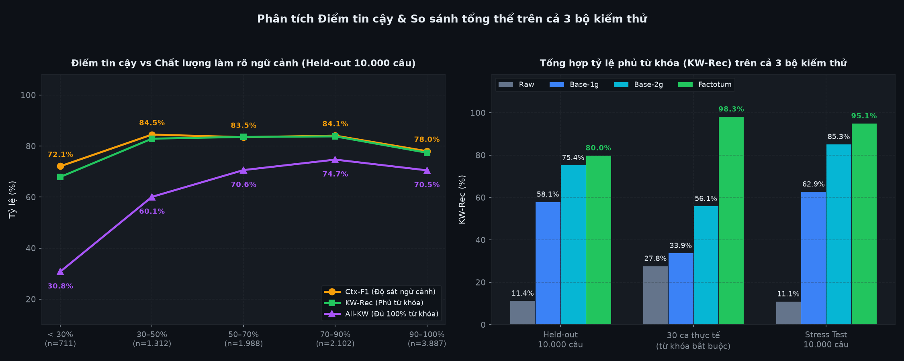

# Báo cáo Đánh giá Thực nghiệm (Factotum)

## Tóm tắt kết quả chính

Báo cáo tổng hợp kết quả kiểm thử Factotum trên **20.030 câu** thuộc 3 bộ dữ liệu độc lập (nguồn số liệu chạy thực tế: [report_10000_20261125_135126.txt](report_10000_20261125_135126.txt)):

| Bộ kiểm thử | Quy mô | Câu gốc chưa xử lý (`KW-Rec`) | Đối chiếu chính (`KW-Rec`) | **Factotum (`KW-Rec` / `All-KW` / `Ctx-F1`)** | Tốc độ trung bình |
| :--- | :---: | :---: | :---: | :---: | :---: |
| **1. Văn bản chưa từng học (Held-out)** | 10.000 câu | 11,4% | Base-2g: 75,4% | **80,0% / 67,2% / 80,8%** | `3,87 ms/câu` |
| **2. Bộ 30 ca thực tế có từ khóa bắt buộc** | 30 câu | 27,8% | Base-2g: 56,1% | **98,3% / 96,7% / 99,3%** | `19,84 ms/câu` |
| **3. Đối đầu trực tiếp với LLM (Held-out)** | 893 cụm trọn nghĩa | 11,3% | Gemini: 71,2% / Claude: 68,9% | **74,7% / 59,2% / 75,5%** | `9,39 giây / 1.000 câu` |
| **4. Kiểm thử tải trên thuật ngữ đã học** | 10.000 câu | 11,1% | Base-2g: 85,3% | **95,1% / 92,5% / 95,4%** | `2,31 ms/câu` |

> Xem quy trình tạo dữ liệu và câu lệnh tự chạy lại toàn bộ benchmark tại [benchmark/README.md](README.md).

---

## 1. Hệ thống chỉ số đánh giá

Đánh giá tập trung vào khả năng **làm rõ ngữ cảnh và khôi phục các từ khóa thực thể cốt lõi** của câu đầu ra thay vì ép so khớp từng chữ với một câu mẫu duy nhất. Cách đo này phản ánh trực tiếp mức độ hữu ích khi Factotum đứng trước công cụ tìm kiếm, trích xuất thực thể hoặc gợi ý:

| Chỉ số | Giải thích |
| :--- | :--- |
| **`KW-Rec`** (Tỷ lệ phủ từ khóa) | Phần trăm từ khóa / thực thể bắt buộc xuất hiện nguyên vẹn trong câu đầu ra. |
| **`All-KW`** (Đủ 100% từ khóa) | Phần trăm câu khôi phục đầy đủ toàn bộ từ khóa bắt buộc của câu đó. |
| **`Ctx-F1`** (Độ sát ngữ cảnh) | Mức độ trùng khớp ngữ cảnh (tính trên các từ mang nghĩa chính, đã loại bỏ hư từ như `của`, `về`, `các`, `và`...) so với câu chuẩn. |

---

## 2. Tổng quan kết quả trên 20.000 câu (Held-out & Kiểm thử tải)

### 2.1. Kiểm thử trên văn bản chưa từng học (124 văn bản học / 32 văn bản mới — 10.000 câu)

Tập dữ liệu gồm 156 văn bản pháp luật được tách hoàn toàn theo từng file (`seed = 42`): 124 văn bản dùng để học (`29,68 giây` dựng mô hình, `100.246` cụm) và 32 văn bản còn lại dùng để sinh 10.000 câu kiểm thử.

| Nhóm câu hỏi | Số câu | Câu gốc (`KW / All / F1`) | Base-1g (`KW / All / F1`) | Base-2g (`KW / All / F1`) | Factotum (`KW / All / F1`) |
| :--- | :---: | :---: | :---: | :---: | :---: |
| Không dấu đã có trong tập học | 936 | 8,6 / 0,0 / 8,1% | 80,4 / 53,3 / 81,7% (`0,05 ms`) | 99,7 / 99,5 / 99,7% (`0,07 ms`) | **100,0 / 100,0 / 100,0%** (`1,18 ms`) |
| Không dấu mới hoàn toàn | 3.064 | 9,8 / 0,3 / 9,1% | 76,3 / 42,9 / 77,7% (`0,05 ms`) | **97,0 / 91,6 / 97,0%** (`0,06 ms`) | 96,7 / 91,4 / 96,5% (`3,53 ms`) |
| Viết tắt hỗn hợp | 2.000 | 30,4 / 1,2 / 27,6% | 64,2 / 18,1 / 65,3% (`0,06 ms`) | 87,3 / 65,3 / 87,6% (`0,14 ms`) | **90,3 / 75,3 / 90,2%** (`6,48 ms`) |
| Thiếu 1 từ ở giữa | 2.000 | 7,3 / 0,2 / 7,8% | 57,6 / 11,7 / 66,0% (`0,04 ms`) | 62,3 / 15,2 / 70,5% (`0,05 ms`) | **75,7 / 46,0 / 80,2%** (`2,25 ms`) |
| Viết tắt toàn cụm | 2.000 | 0,0 / 0,0 / 0,0% | 14,5 / 1,6 / 14,5% (`0,04 ms`) | 32,4 / 18,2 / 32,3% (`2,63 ms`) | **39,0 / 28,0 / 39,1%** (`4,68 ms`) |
| **Tổng cộng** | **10.000** | **11,4 / 0,4 / 10,6%** | **58,1 / 24,4 / 60,6%** (`0,05 ms`) | **75,4 / 57,1 / 77,1%** (`0,59 ms`) | **80,0 / 67,2 / 80,8%** (**`3,87 ms`**) |

**Nhận xét:**
- So với câu gốc chưa xử lý, Factotum nâng tỷ lệ phủ từ khóa thêm **`+68,6%`** (`11,4% → 80,0%`) và độ sát ngữ cảnh thêm **`+70,2%`** (`10,6% → 80,8%`).
- So với `Base-2g` (Bigram + Viterbi), Factotum vượt **`+4,6%` KW-Rec** và **`+10,1%` All-KW**, cách biệt lớn nhất nằm ở các nhóm khó: **thiếu từ ở giữa** (`46,0%` vs `15,2%` All-KW), **viết tắt hỗn hợp** (`75,3%` vs `65,3%` All-KW) và **viết tắt toàn cụm** (`28,0%` vs `18,2%` All-KW).
- Tốc độ trung bình đạt **`3,87 ms/câu`** (trung vị `2,45 ms`, tốc độ xử lý `258 câu/giây`).

### 2.2. Kiểm thử tải 10.000 câu trên thuật ngữ đã học

Đo tốc độ và độ ổn định trên kho tri thức đầy đủ (`113.107` cụm, `3.399` từ đơn, thời gian nạp vào RAM `0,386 giây`):

| Nhóm câu hỏi | Số câu | Câu gốc (`KW / All / F1`) | Base-1g (`KW / All / F1`) | Base-2g (`KW / All / F1`) | Factotum (`KW / All / F1`) |
| :--- | :---: | :---: | :---: | :---: | :---: |
| Không dấu | 5.000 | 9,4 / 1,2 / 8,7% | 78,9 / 57,3 / 79,9% (`0,04 ms`) | 99,3 / 99,0 / 99,3% (`0,05 ms`) | **99,8 / 99,7 / 99,8%** (`1,59 ms`) |
| Viết tắt hỗn hợp | 2.000 | 27,5 / 1,1 / 25,5% | 63,8 / 21,6 / 64,5% (`0,06 ms`) | 94,6 / 85,4 / 94,6% (`0,14 ms`) | **98,6 / 96,4 / 98,5%** (`5,90 ms`) |
| Viết tắt toàn cụm | 1.500 | 0,0 / 0,0 / 0,0% | 16,8 / 4,5 / 16,2% (`0,04 ms`) | 53,8 / 43,5 / 53,3% (`2,36 ms`) | **82,2 / 78,6 / 82,2%** (**`0,23 ms`**) |
| Thiếu 1 từ ở giữa | 1.500 | 6,3 / 0,1 / 6,8% | 54,2 / 6,5 / 64,6% (`0,04 ms`) | 57,5 / 7,3 / 67,5% (`0,04 ms`) | **87,8 / 77,1 / 90,0%** (`1,99 ms`) |
| **Tổng cộng** | **10.000** | **11,1 / 0,8 / 10,5%** | **62,9 / 34,6 / 65,0%** (`0,05 ms`) | **85,3 / 74,2 / 86,7%** (`0,42 ms`) | **95,1 / 92,5 / 95,4%** (**`2,31 ms`**) |

- Trung vị `1,43 ms/câu`, tốc độ **`433 câu/giây`**, vượt `Base-2g` **`+9,8%` KW-Rec** và **`+18,3%` All-KW**.
- Danh sách chi tiết các câu còn thiếu từ khóa được xuất cục bộ ra file `benchmark/failures.csv` khi chạy lại script.

---

## 3. Bộ test 30 ca thực tế có từ khóa bắt buộc ([context_cases.json](context_cases.json))

Bộ dữ liệu gồm 30 câu gõ thực tế có gán danh sách từ khóa thực thể bắt buộc (như `csgt xpvphc người không có gplx`, `nd 23/24 quy định về atgt đường bộ`, `tòa án nd tối cao`, lỗi rơi từ và gõ Telex):

| Nhóm câu hỏi | Số câu | Câu gốc (`KW / All / F1`) | Base-1g (`KW / All / F1`) | Base-2g (`KW / All / F1`) | Factotum (`KW / All / F1`) |
| :--- | :---: | :---: | :---: | :---: | :---: |
| Giải nhập nhằng ngữ cảnh | 10 | 51,7 / 10,0 / 76,1% | 46,7 / 20,0 / 78,9% (`0,10 ms`) | 70,0 / 50,0 / 92,6% (`0,59 ms`) | **100,0 / 100,0 / 100,0%** (`16,64 ms`) |
| Bổ sung từ rơi ở giữa | 5 | 10,0 / 0,0 / 22,3% | 20,0 / 0,0 / 65,8% (`0,04 ms`) | 20,0 / 0,0 / 76,5% (`0,05 ms`) | **100,0 / 100,0 / 100,0%** (`3,08 ms`) |
| Nhiều thực thể viết tắt | 10 | 15,0 / 0,0 / 54,4% | 15,0 / 0,0 / 48,8% (`0,15 ms`) | 53,3 / 20,0 / 80,4% (`3,87 ms`) | **95,0 / 90,0 / 97,8%** (`36,79 ms`) |
| Lỗi Telex & chính tả | 5 | 23,3 / 0,0 / 46,9% | 60,0 / 20,0 / 59,3% (`0,10 ms`) | 70,0 / 40,0 / 74,5% (`0,97 ms`) | **100,0 / 100,0 / 100,0%** (`9,10 ms`) |
| **Tổng cộng** | **30** | **27,8 / 3,3 / 55,0%** | **33,9 / 10,0 / 63,4%** (`0,11 ms`) | **56,1 / 30,0 / 82,8%** (`1,66 ms`) | **98,3 / 96,7 / 99,3%** (**`19,84 ms`**) |

**Nhận xét:**
- Factotum đạt **29/30 câu đủ 100% từ khóa bắt buộc** (`98,3% KW-Rec`, vượt `Base-2g` **`+42,2%` KW-Rec** và **`+66,7%` All-KW**).
- 3/4 nhóm đạt **100%** tuyệt đối; câu duy nhất còn thiếu 1 từ khóa là `'nhà nước ban hành nd về luật ld'` → `'nhà nước ban hành nội dung về luật lao động'` (`Ctx-F1 = 78%`, vẫn giữ rõ ngữ cảnh chính về luật lao động).

---

## 4. Đối đầu trực tiếp với LLM (Gemini Hydrogen & Claude Sonnet 5.5, zero-shot)

Rút `1.000` câu độc nhất từ 32 văn bản chưa từng học (`seed = 42`, chia đều 4 nhóm), lọc bỏ `107` cụm kết thúc cụt lủn theo `../output/dangling_end_words.txt` còn **`893` cụm trọn nghĩa**. Hai mô hình ngôn ngữ lớn chạy ở chế độ zero-shot trên cùng một prompt (trả lời đủ `1.000/1.000` câu), sau đó toàn bộ kết quả được chấm đồng nhất theo cùng 3 chỉ số `KW-Rec / All-KW / Ctx-F1`:

| Nhóm câu hỏi | Số câu | Câu gốc (`KW / All / F1`) | **Factotum (`KW / All / F1`)** | Gemini Hydrogen, zero-shot (`KW / All / F1`) | Claude Sonnet 5.5, zero-shot (`KW / All / F1`) |
| :--- | :---: | :---: | :---: | :---: | :---: |
| Không dấu mới hoàn toàn | 227 | 9,7 / 0,4 / 9,0% | **96,9 / 91,2 / 96,6%** | 93,9 / 85,9 / 93,8% | 92,5 / 80,2 / 92,8% |
| Viết tắt hỗn hợp | 219 | 31,3 / 1,4 / 28,4% | 88,5 / 70,8 / 88,2% | 88,7 / 69,9 / 88,7% | **89,0 / 72,6 / 89,1%** |
| Thiếu 1 từ ở giữa | 227 | 4,4 / 0,4 / 4,6% | **74,4 / 47,1 / 78,4%** | 73,5 / 44,9 / 76,0% | 72,9 / 46,7 / 72,9% |
| Viết tắt toàn cụm | 220 | 0,0 / 0,0 / 0,0% | **38,6 / 27,3 / 38,2%** | 27,8 / 10,9 / 26,4% | 20,3 / 5,5 / 18,4% |
| **Tổng cộng (cụm trọn nghĩa)** | **893** | **11,3 / 0,6 / 10,4%** | **74,7 / 59,2 / 75,5%** | **71,2 / 53,1 / 71,4%** | **68,9 / 51,4 / 68,5%** |
| **Thời gian chạy 1.000 câu** | | | **`9,39 giây`** (cục bộ, `1,29 MB`) | `~15 giây` (batch cloud) | `~20 phút` (cloud) |

*Lưu ý đối chiếu công bằng:* Hai LLM chạy zero-shot (không RAG, không tinh chỉnh trên 124 văn bản luật), trong khi Factotum đã học trực tiếp từ 124 văn bản cùng lĩnh vực. Nếu tính trên đủ `1.000` câu thô (gồm cả `107` cụm cụt lủn mà Factotum chủ động giữ nguyên câu gốc để tránh trả lời cụt nghĩa), Factotum đạt `70,5% KW-Rec / 55,5% All-KW / 70,6% Ctx-F1` (vẫn cao hơn về tỷ lệ đủ 100% từ khóa so với Gemini `53,9%` và Claude `52,4%`). Riêng ở nhóm viết tắt toàn cụm chuyên ngành, Factotum đạt tỷ lệ đủ 100% từ khóa (`27,3%`) cao gấp **2,5 lần Gemini** (`10,9%`) và gấp **5 lần Claude** (`5,5%`).

---

## 5. Phân tích Điểm tin cậy & So sánh tổng hợp

| Mức điểm tin cậy (`confidence`) | Số câu (Held-out) | `confidence` TB | `KW-Rec` | `All-KW` | `Ctx-F1` | Khuyến nghị ứng dụng |
| :---: | :---: | :---: | :---: | :---: | :---: | :--- |
| `90 – 100%` | 3.887 | 95,3% | 77,4% | 70,5% | 78,0% | Tự động áp dụng |
| `70 – 90%` | 2.102 | 80,7% | **83,8%** | **74,7%** | **84,1%** | Tự động áp dụng |
| `50 – 70%` | 1.988 | 57,6% | 83,6% | 70,6% | 83,5% | Hiển thị gợi ý |
| `30 – 50%` | 1.312 | 44,4% | 82,9% | 60,1% | 84,5% | Hiển thị gợi ý |
| `< 30%` | 711 | 9,5% | 67,9% | 30,8% | 72,1% | Giữ nguyên câu gốc |

Ở nhóm `confidence < 30%` (`711` câu), tỷ lệ đủ 100% từ khóa giảm rõ rệt còn `30,8%`, giúp ứng dụng dễ dàng đặt ngưỡng an toàn để tránh sửa nhầm những câu quá mơ hồ.

---

## 6. Tỷ lệ tăng trưởng dữ liệu theo văn bản đầu vào

| Số văn bản | Số từ đầu vào (`N`) | Dung lượng văn bản thô | File tri thức `.txt` (chưa nén) | Số từ lưu trong kho cụm | File đóng gói `.ftm` |
| :---: | :---: | :---: | :---: | :---: | :---: |
| 10 | 365.615 từ | 2,13 MB | 8,57 MB (**402%**) | 232.179 từ (**63,5%**) | 434,9 KB (**20,0%**) |
| 30 | 860.123 từ | 5,01 MB | 13,58 MB (**271%**) | 400.387 từ (**46,5%**) | 707,4 KB (**13,8%**) |
| 80 | 1.218.295 từ | 7,10 MB | 15,04 MB (**212%**) | 455.391 từ (**37,4%**) | 796,4 KB (**11,0%**) |
| 156 | 2.618.007 từ | 15,21 MB | 24,51 MB (**161%**) | 775.032 từ (**29,6%**) | 1,29 MB (**8,5%**, nén `11,8 : 1`) |

Khi số văn bản tăng gần 16 lần (`10 → 156` văn bản), kích thước file `.ftm` chỉ tăng khoảng 3 lần (`434,9 KB → 1,29 MB`, tỷ lệ tăng trưởng dưới tuyến tính $S_{\text{ftm}} \propto N^{0.56}$).

---

## 7. So sánh tổng quan với các phương pháp khác

Số liệu `Base-1g`, `Base-2g` và `Factotum` lấy từ Held-out 10.000 câu và bộ `context_cases.json`; cột `LLM (zero-shot)` tham chiếu kết quả đo trực tiếp trên `893` cụm trọn nghĩa ở mục 4:

| Tiêu chí | `Base-1g` (Unigram) | `Base-2g` (Bigram + Viterbi) | **Factotum** | SymSpell / Edit Distance* | LLM (zero-shot) |
| :--- | :---: | :---: | :---: | :---: | :---: |
| Làm rõ ngữ cảnh (Held-out 10.000 câu) | `58,1%` KW-Rec | `75,4%` KW-Rec (`57,1%` All-KW) | **`80,0%` KW-Rec (`67,2%` All-KW)** | Không hỗ trợ viết tắt/dấu | `68,9% – 71,2%` KW-Rec (mục 4) |
| Giải nhập nhằng & nhiều thực thể (30 ca) | `33,9%` KW-Rec | `56,1%` KW-Rec (`30,0%` All-KW) | **`98,3%` KW-Rec (`96,7%` All-KW)** | Không | Cao* |
| Viết tắt toàn cụm chuyên ngành (mục 4) | `14,5%` KW-Rec | `32,4%` KW-Rec | **`38,6%` KW-Rec (`27,3%` All-KW)** | Không | `20,3% – 27,8%` KW-Rec (`5,5% – 10,9%` All-KW) |
| Bổ sung từ rơi ở giữa (Held-out) | `11,7%` All-KW | `15,2%` All-KW | **`46,0%` All-KW (`80,2%` Ctx-F1)** | Không | `44,9% – 46,7%` All-KW (mục 4) |
| Sửa lỗi chính tả & gõ Telex | Không | Không | Có, giữ nguyên từ đúng | Tốt (từng từ đơn) | Tốt |
| Tự học từ dữ liệu nội bộ | Nhanh | Nhanh | `~30 giây` (bản C++) | Nhanh | Chậm, thường cần GPU |
| Dung lượng lưu trữ / RAM | Vài MB | Vài MB | `1,29 MB` đĩa / `~150–200 MB` RAM | Rất nhỏ | `400 MB` – hàng chục GB* |
| Tốc độ xử lý | `0,05 ms/câu` | `0,59 ms/câu` | `2,31 – 3,87 ms/câu` | `< 1 ms/câu`* | `~15 ms` (batch) – `1,2 s/câu` |

*\*Khoảng tham khảo định tính tùy kiến trúc mô hình và phần cứng.*

---

## 8. Giới hạn của bộ kiểm thử

- Các văn bản quy phạm pháp luật có độ lặp mẫu câu hành chính cao, nên khi tách theo file vẫn có thể còn trùng lặp một phần cấu trúc câu; chưa đánh giá chéo sang lĩnh vực khác (như y tế, tài chính).
- Hai bộ 10.000 câu được sinh tự động từ văn bản thực tế; riêng bộ 30 câu [context_cases.json](context_cases.json) được thiết kế thủ công cho các tình huống nhập nhằng và nhiều viết tắt dài.
