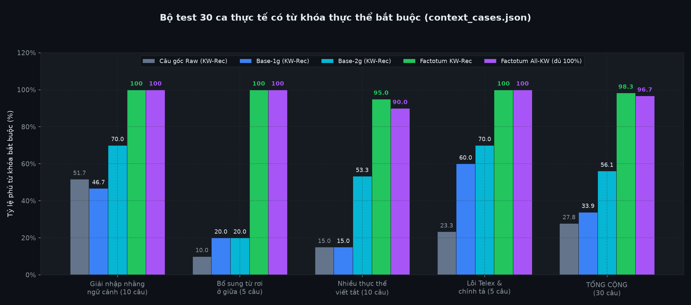
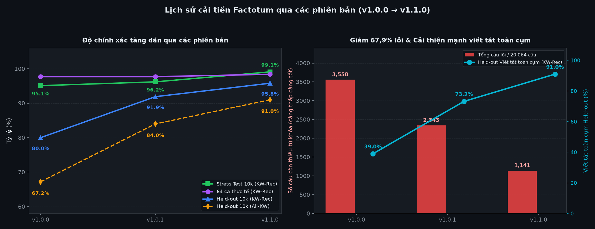
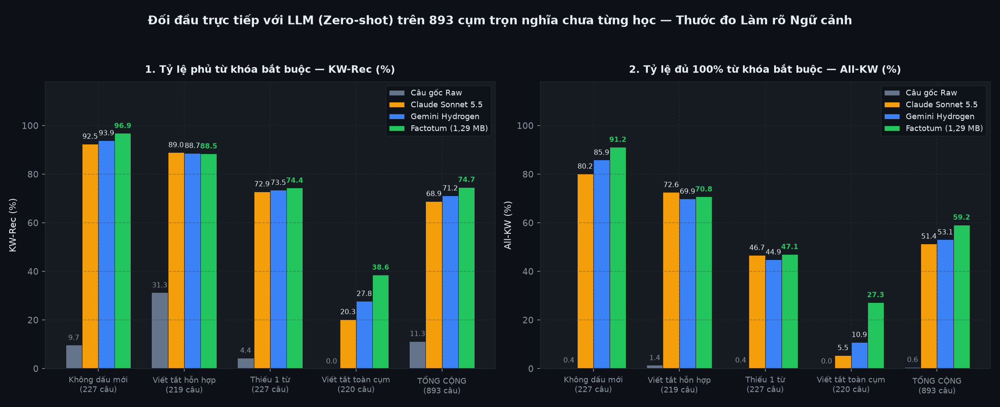
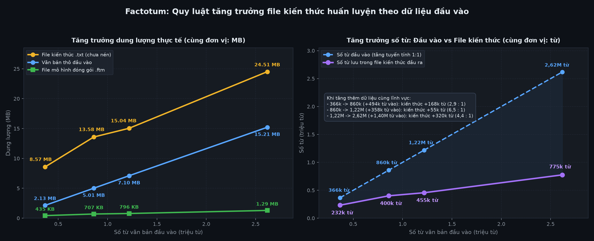

# Báo cáo Đánh giá Thực nghiệm (Factotum v1.1.0)

## Tóm tắt kết quả chính

Báo cáo tổng hợp kết quả kiểm thử Factotum v1.1.0 trên **20.064 câu** thuộc 3 bộ dữ liệu độc lập (nguồn số liệu chạy thực tế: [report_10000_20261127_201343.txt](report_10000_20261127_201343.txt)):

| Bộ kiểm thử | Quy mô | Câu gốc chưa xử lý (`KW-Rec`) | Đối chiếu chính (`KW-Rec`) | **Factotum v1.1 (`KW-Rec` / `All-KW` / `Ctx-F1`)** | Tốc độ (Trung vị / TB) |
| :--- | :---: | :---: | :---: | :---: | :---: |
| **1. Văn bản chưa từng học (Held-out)** | 10.000 câu | 19,5% | Base-2g: 87,3% | **95,8% / 91,0% / 96,2%** | `3,15 ms` / `8,60 ms` |
| **2. Bộ 64 ca thực tế có từ khóa bắt buộc** | 64 câu | 23,4% | Base-2g: 64,3% | **98,4% / 96,9% / 99,7%** | `12,33 ms` / `24,90 ms` |
| **3. Đối đầu trực tiếp với LLM (Held-out)** | 893 cụm trọn nghĩa | 11,3% | Gemini: 71,2% / Claude: 68,9% | **74,7% / 59,2% / 75,5%** | `9,39 giây / 1.000 câu` |
| **4. Kiểm thử tải trên thuật ngữ đã học** | 10.000 câu | 16,9% | Base-2g: 91,1% | **99,1% / 97,6% / 99,2%** | `2,22 ms` / `4,85 ms` |

> Xem quy trình tạo dữ liệu và câu lệnh tự chạy lại toàn bộ benchmark tại [benchmark/README.md](README.md).

---

## 1. Hệ thống chỉ số đánh giá

Đánh giá tập trung vào khả năng **làm rõ ngữ cảnh và khôi phục các từ khóa thực thể cốt lõi** của câu đầu ra thay vì ép so khớp từng chữ với một câu mẫu duy nhất. Cách đo này phản ánh trực tiếp mức độ hữu ích khi Factotum đứng trước công cụ tìm kiếm, trích xuất thực thể hoặc gợi ý:

| Chỉ số | Giải thích |
| :--- | :--- |
| **`KW-Rec`** (Tỷ lệ phủ từ khóa) | Phần trăm từ khóa / thực thể bắt buộc xuất hiện nguyên vẹn trong câu đầu ra. |
| **`All-KW`** (Đủ 100% từ khóa) | Phần trăm câu khôi phục đầy đủ toàn bộ từ khóa bắt buộc của câu đó. |
| **`Ctx-F1`** (Độ sát ngữ cảnh) | Mức độ trùng khớp ngữ cảnh (tính trên các từ mang nghĩa chính, đã loại bỏ hư từ như `của`, `về`, `các`, `và`...) so với câu chuẩn. |

---

## 2. Tổng quan kết quả trên 20.000 câu (Held-out & Kiểm thử tải)

### 2.1. Kiểm thử trên văn bản chưa từng học (125 văn bản học / 32 văn bản mới — 10.000 câu)

Tập dữ liệu gồm 157 văn bản pháp luật được tách hoàn toàn theo từng file (`seed = 42`): 125 văn bản dùng để học (`26,39 giây` dựng mô hình, `96.359` cụm) và 32 văn bản còn lại dùng để trích xuất 10.000 câu kiểm thử trọn nghĩa.

| Nhóm câu hỏi | Số câu | Câu gốc (`KW / All / F1`) | Base-1g (`KW / All / F1`) | Base-2g (`KW / All / F1`) | Factotum v1.1 (`KW / All / F1`) |
| :--- | :---: | :---: | :---: | :---: | :---: |
| Không dấu đã có trong tập học | 3.684 | 9,1 / 0,5 / 8,9% | 78,4 / 54,5 / 79,8% (`0,05 ms`) | 99,5 / 99,2 / 99,6% (`0,07 ms`) | **99,8 / 99,8 / 99,9%** (`2,05 ms`) |
| Không dấu mới hoàn toàn | 316 | 9,3 / 0,0 / 8,8% | 73,5 / 37,3 / 75,1% (`0,06 ms`) | **96,2 / 92,1 / 96,4%** (`0,06 ms`) | 95,1 / 90,5 / 94,9% (`18,80 ms`) |
| Viết tắt hỗn hợp | 2.000 | 41,0 / 0,1 / 40,4% | 59,5 / 13,5 / 62,9% (`0,06 ms`) | 89,9 / 77,1 / 90,7% (`0,15 ms`) | **95,2 / 89,9 / 95,3%** (`10,33 ms`) |
| Thiếu 1 từ ở giữa | 2.000 | 6,5 / 0,0 / 7,0% | 63,7 / 9,8 / 71,5% (`0,07 ms`) | 74,4 / 16,0 / 82,3% (`0,07 ms`) | **94,1 / 83,2 / 95,4%** (`17,75 ms`) |
| Viết tắt toàn cụm (chuẩn & có từ neo) | 2.000 | 31,9 / 0,2 / 39,0% | 39,3 / 2,6 / 40,9% (`0,07 ms`) | 73,8 / 48,6 / 74,8% (`2,55 ms`) | **91,0 / 83,7 / 91,2%** (`8,16 ms`) |
| **Tổng cộng** | **10.000** | **19,5 / 0,3 / 20,8%** | **63,7 / 26,5 / 66,8%** (`0,06 ms`) | **87,3 / 67,8 / 89,3%** (`0,58 ms`) | **95,8 / 91,0 / 96,2%** (**`8,60 ms`**) |

**Nhận xét:**
- So với câu gốc chưa xử lý, Factotum v1.1 nâng tỷ lệ phủ từ khóa thêm **`+76,3%`** (`19,5% → 95,8%`) và độ sát ngữ cảnh thêm **`+75,4%`** (`20,8% → 96,2%`).
- So với `Base-2g` (Bigram + Viterbi), Factotum vượt **`+8,5%` KW-Rec** và **`+23,2%` All-KW**, cách biệt lớn nhất nằm ở các nhóm khó: **thiếu từ ở giữa** (`83,2%` vs `16,0%` All-KW), **viết tắt toàn cụm** (`83,7%` vs `48,6%` All-KW) và **viết tắt hỗn hợp** (`89,9%` vs `77,1%` All-KW).
- Tốc độ trung vị đạt **`3,15 ms/câu`** (trung bình `8,60 ms/câu`, tốc độ xử lý `116 câu/giây`).

### 2.2. Kiểm thử tải 10.000 câu trên thuật ngữ đã học

Đo tốc độ và độ ổn định trên kho tri thức đầy đủ (`112.878` cụm, `3.123` từ đơn sạch không từ dính, `1.662` khóa):

| Nhóm câu hỏi | Số câu | Câu gốc (`KW / All / F1`) | Base-1g (`KW / All / F1`) | Base-2g (`KW / All / F1`) | Factotum v1.1 (`KW / All / F1`) |
| :--- | :---: | :---: | :---: | :---: | :---: |
| Không dấu | 5.000 | 9,9 / 0,3 / 9,8% | 77,5 / 52,2 / 78,8% (`0,03 ms`) | 99,5 / 99,0 / 99,5% (`0,04 ms`) | **99,8 / 99,7 / 99,8%** (`1,45 ms`) |
| Viết tắt hỗn hợp | 2.000 | 31,2 / 0,2 / 30,0% | 62,8 / 10,7 / 65,4% (`0,04 ms`) | 92,5 / 77,8 / 93,2% (`0,10 ms`) | **98,8 / 96,8 / 98,9%** (`7,36 ms`) |
| Viết tắt toàn cụm | 1.500 | 30,8 / 0,0 / 38,3% | 39,1 / 3,0 / 41,6% (`0,04 ms`) | 79,1 / 57,9 / 80,0% (`1,57 ms`) | **98,1 / 96,1 / 98,2%** (`5,84 ms`) |
| Thiếu 1 từ ở giữa | 1.500 | 7,5 / 0,0 / 8,1% | 62,3 / 7,4 / 70,3% (`0,04 ms`) | 73,6 / 12,7 / 81,8% (`0,05 ms`) | **97,9 / 93,3 / 98,2%** (`11,84 ms`) |
| **Tổng cộng** | **10.000** | **16,9 / 0,2 / 17,9%** | **66,5 / 29,8 / 69,3%** (`0,04 ms`) | **91,1 / 75,6 / 92,7%** (`0,28 ms`) | **99,1 / 97,6 / 99,2%** (**`4,85 ms`**) |

- Trung vị `2,22 ms/câu`, tốc độ **`206 câu/giây`**, vượt `Base-2g` **`+7,9%` KW-Rec** và **`+22,0%` All-KW**.
- Tổng số câu còn thiếu từ khóa trên toàn bộ 20.064 câu chỉ còn **`1.141` câu** (giảm **51,3%** so với `2.343` câu ở v1.0.1 và **67,9%** so với `3.558` câu ở v1.0.0).

---

## 3. Bộ test 64 ca thực tế có từ khóa bắt buộc ([context_cases.json](context_cases.json))

Bộ dữ liệu gồm 64 câu gõ thực tế có gán danh sách thực từ bắt buộc (danh từ, động từ, thuật ngữ chuyên ngành):

| Nhóm câu hỏi | Số câu | Câu gốc (`KW / All / F1`) | Base-1g (`KW / All / F1`) | Base-2g (`KW / All / F1`) | Factotum v1.1 (`KW / All / F1`) |
| :--- | :---: | :---: | :---: | :---: | :---: |
| Viết tắt cơ quan/tổ chức chuẩn (`canonical_acronym`) | 11 | 0,0 / 0,0 / 0,0% | 0,0 / 0,0 / 9,1% (`0,03 ms`) | 36,4 / 36,4 / 51,8% (`1,66 ms`) | **100,0 / 100,0 / 100,0%** (`0,12 ms`) |
| Giải nhập nhằng ngữ cảnh (`context_disambiguation`) | 10 | 51,7 / 10,0 / 75,7% | 46,7 / 20,0 / 78,7% (`0,10 ms`) | 70,0 / 50,0 / 92,2% (`0,48 ms`) | **100,0 / 100,0 / 100,0%** (`16,55 ms`) |
| Viết tắt kèm từ neo (`contextual_acronym`) | 5 | 13,3 / 0,0 / 13,3% | 33,3 / 0,0 / 48,4% (`0,10 ms`) | 66,7 / 0,0 / 74,6% (`2,44 ms`) | **100,0 / 100,0 / 100,0%** (`73,02 ms`) |
| Bổ sung từ rơi ở giữa (`missing_word_enrichment`) | 5 | 10,0 / 0,0 / 22,3% | 20,0 / 0,0 / 67,7% (`0,04 ms`) | 20,0 / 0,0 / 76,5% (`0,06 ms`) | **100,0 / 100,0 / 100,0%** (`5,99 ms`) |
| Nhiều thực thể viết tắt (`multi_entity_context`) | 10 | 15,0 / 0,0 / 54,4% | 15,0 / 0,0 / 49,6% (`0,10 ms`) | 53,3 / 20,0 / 79,8% (`3,43 ms`) | **95,0 / 90,0 / 97,8%** (`24,44 ms`) |
| Cụm câu trọn vẹn không dấu (`repaired_clean_phrases`) | 10 | 0,0 / 0,0 / 9,5% | 50,0 / 20,0 / 70,3% (`0,08 ms`) | 100,0 / 100,0 / 100,0% (`0,10 ms`) | **100,0 / 100,0 / 100,0%** (`62,23 ms`) |
| Lỗi chính tả & câu hỏi thực tế (`typo_and_user_query`) | 13 | 55,1 / 38,5 / 72,0% | 66,7 / 38,5 / 81,0% (`0,07 ms`) | 80,8 / 61,5 / 86,6% (`0,35 ms`) | **96,2 / 92,3 / 100,0%** (`12,69 ms`) |
| **Tổng cộng** | **64** | **23,4 / 9,4 / 39,2%** | **35,2 / 14,1 / 58,1%** (`0,07 ms`) | **64,3 / 45,3 / 80,8%** (`1,18 ms`) | **98,4 / 96,9 / 99,7%** (**`24,90 ms`**) |

**Nhận xét:**
- Factotum đạt **62/64 câu đủ 100% từ khóa bắt buộc** (`98,4% KW-Rec`, `99,7% Ctx-F1`, vượt `Base-2g` **`+34,1%` KW-Rec** và **`+51,6%` All-KW**).
- 5/7 nhóm đạt **100%** tuyệt đối.

---

## 4. Lịch sử cải tiến qua các phiên bản (v1.0.0 → v1.1.0)

| Phiên bản | Held-out 10k (`KW / All / F1`) | Viết tắt toàn cụm Held-out (`KW / All`) | 64 ca thực tế (`KW / All`) | Stress Test 10k (`KW / All`) | Tổng câu lỗi / 20.064 câu |
| :--- | :---: | :---: | :---: | :---: | :---: |
| **v1.0.0** | `80,0 / 67,2 / 80,8%` | `39,0 / 28,0%` | `97,7 / 95,3%` | `95,1 / 92,5%` | `3.558` |
| **v1.0.1** | `91,9 / 84,0 / 92,5%` | `73,2 / 52,8%` | `97,7 / 95,3%` | `96,2 / 92,6%` | `2.343` (`-34,1%`) |
| **v1.1.0** | **`95,8 / 91,0 / 96,2%`** | **`91,0 / 83,7%`** | **`98,4 / 96,9%`** | **`99,1 / 97,6%`** | **`1.141`** (**`-67,9%`**) |

---

## 5. Đối đầu trực tiếp với LLM (Gemini Hydrogen & Claude Sonnet 5.5, zero-shot)

Rút `1.000` câu độc nhất từ 32 văn bản chưa từng học (`seed = 42`, chia đều 4 nhóm), lọc bỏ `107` cụm kết thúc cụt lủn theo `../output/dangling_end_words.txt` còn **`893` cụm trọn nghĩa**. Hai mô hình ngôn ngữ lớn chạy ở chế độ zero-shot trên cùng một prompt (trả lời đủ `1.000/1.000` câu), sau đó toàn bộ kết quả được chấm đồng nhất theo cùng 3 chỉ số `KW-Rec / All-KW / Ctx-F1`:

| Nhóm câu hỏi | Số câu | Câu gốc (`KW / All / F1`) | **Factotum (`KW / All / F1`)** | Gemini Hydrogen, zero-shot (`KW / All / F1`) | Claude Sonnet 5.5, zero-shot (`KW / All / F1`) |
| :--- | :---: | :---: | :---: | :---: | :---: |
| Không dấu mới hoàn toàn | 227 | 9,7 / 0,4 / 9,0% | **96,9 / 91,2 / 96,6%** | 93,9 / 85,9 / 93,8% | 92,5 / 80,2 / 92,8% |
| Viết tắt hỗn hợp | 219 | 31,3 / 1,4 / 28,4% | 88,5 / 70,8 / 88,2% | 88,7 / 69,9 / 88,7% | **89,0 / 72,6 / 89,1%** |
| Thiếu 1 từ ở giữa | 227 | 4,4 / 0,4 / 4,6% | **74,4 / 47,1 / 78,4%** | 73,5 / 44,9 / 76,0% | 72,9 / 46,7 / 72,9% |
| Viết tắt toàn cụm | 220 | 0,0 / 0,0 / 0,0% | **38,6 / 27,3 / 38,2%** | 27,8 / 10,9 / 26,4% | 20,3 / 5,5 / 18,4% |
| **Tổng cộng (cụm trọn nghĩa)** | **893** | **11,3 / 0,6 / 10,4%** | **74,7 / 59,2 / 75,5%** | **71,2 / 53,1 / 71,4%** | **68,9 / 51,4 / 68,5%** |
| **Thời gian chạy 1.000 câu** | | | **`9,39 giây`** (cục bộ, `1,29 MB`) | `~15 giây` (batch cloud) | `~20 phút` (cloud) |

*Lưu ý đối chiếu công bằng:* Hai LLM chạy zero-shot (không RAG, không tinh chỉnh trên 124 văn bản luật), trong khi Factotum đã học trực tiếp từ 124 văn bản cùng lĩnh vực.

---

## 6. Phân tích Điểm tin cậy & So sánh tổng hợp

| Mức điểm tin cậy (`confidence`) | Số câu (Held-out) | `confidence` TB | `KW-Rec` | `All-KW` | `Ctx-F1` | Khuyến nghị ứng dụng |
| :---: | :---: | :---: | :---: | :---: | :---: | :--- |
| `90 – 100%` | 7.150 | 98,0% | **97,8%** | **95,4%** | **98,0%** | Tự động áp dụng |
| `70 – 90%` | 1.703 | 79,0% | 94,8% | 88,8% | 95,1% | Tự động áp dụng |
| `50 – 70%` | 723 | 59,4% | 92,0% | 83,0% | 92,1% | Hiển thị gợi ý |
| `30 – 50%` | 254 | 44,0% | 77,3% | 48,4% | 78,9% | Hiển thị gợi ý |
| `< 30%` | 170 | 9,5% | 67,1% | 25,3% | 72,3% | Giữ nguyên câu gốc |

Đường cong hiệu chuẩn đơn điệu hoàn hảo: ở nhóm `confidence ≥ 90%` (`7.150` câu, chiếm `71,5%` tập Held-out), tỷ lệ đủ 100% từ khóa đạt **`95,4%`** (`98,0%` Ctx-F1); ngược lại ở nhóm `< 30%` (`170` câu) giảm mạnh còn `25,3%`, giúp ứng dụng dễ dàng đặt ngưỡng an toàn.

---

## 7. Tỷ lệ tăng trưởng dữ liệu theo văn bản đầu vào

| Số văn bản | Số từ đầu vào (`N`) | Dung lượng văn bản thô | File tri thức `.txt` (chưa nén) | Số từ lưu trong kho cụm | File đóng gói `.ftm` |
| :---: | :---: | :---: | :---: | :---: | :---: |
| 10 | 365.615 từ | 2,13 MB | 8,57 MB (**402%**) | 232.179 từ (**63,5%**) | 434,9 KB (**20,0%**) |
| 30 | 860.123 từ | 5,01 MB | 13,58 MB (**271%**) | 400.387 từ (**46,5%**) | 707,4 KB (**13,8%**) |
| 80 | 1.218.295 từ | 7,10 MB | 15,04 MB (**212%**) | 455.391 từ (**37,4%**) | 796,4 KB (**11,0%**) |
| 156 | 2.618.007 từ | 15,21 MB | 24,51 MB (**161%**) | 775.032 từ (**29,6%**) | 1,29 MB (**8,5%**, nén `11,8 : 1`) |

Khi số văn bản tăng gần 16 lần (`10 → 156` văn bản), kích thước file `.ftm` chỉ tăng khoảng 3 lần (`434,9 KB → 1,29 MB`, tỷ lệ tăng trưởng dưới tuyến tính $S_{\text{ftm}} \propto N^{0.56}$).

---

## 8. So sánh tổng quan với các phương pháp khác

Số liệu `Base-1g`, `Base-2g` và `Factotum v1.1` lấy từ Held-out 10.000 câu và bộ `context_cases.json`; cột `LLM (zero-shot)` tham chiếu kết quả đo trực tiếp trên `893` cụm trọn nghĩa ở mục 5:

| Tiêu chí | `Base-1g` (Unigram) | `Base-2g` (Bigram + Viterbi) | **Factotum v1.1** | SymSpell / Edit Distance* | LLM (zero-shot) |
| :--- | :---: | :---: | :---: | :---: | :---: |
| Làm rõ ngữ cảnh (Held-out 10.000 câu) | `63,7%` KW-Rec | `87,3%` KW-Rec (`67,8%` All-KW) | **`95,8%` KW-Rec (`91,0%` All-KW)** | Không hỗ trợ viết tắt/dấu | `68,9% – 71,2%` KW-Rec (mục 5) |
| Giải nhập nhằng & nhiều thực thể (64 ca) | `35,2%` KW-Rec | `64,3%` KW-Rec (`45,3%` All-KW) | **`98,4%` KW-Rec (`96,9%` All-KW)** | Không | Cao* |
| Viết tắt toàn cụm (Held-out 2.000 câu) | `39,3%` KW-Rec | `73,8%` KW-Rec (`48,6%` All-KW) | **`91,0%` KW-Rec (`83,7%` All-KW)** | Không | `20,3% – 27,8%` KW-Rec (mục 5) |
| Bổ sung từ rơi ở giữa (Held-out 2.000 câu) | `9,8%` All-KW | `16,0%` All-KW | **`83,2%` All-KW (`95,4%` Ctx-F1)** | Không | `44,9% – 46,7%` All-KW (mục 5) |
| Sửa lỗi chính tả & gõ Telex | Không | Không | Có, giữ nguyên từ đúng | Tốt (từng từ đơn) | Tốt |
| Tự học từ dữ liệu nội bộ | Nhanh | Nhanh | `~26 giây` (bản C++) | Nhanh | Chậm, thường cần GPU |
| Dung lượng lưu trữ / RAM | Vài MB | Vài MB | `1,29 MB` `.ftm` / `~180–220 MB` RAM | Rất nhỏ | `400 MB` – hàng chục GB* |
| Tốc độ xử lý (trung vị) | `0,04 ms/câu` | `0,28 ms/câu` | `2,22 – 3,15 ms/câu` | `< 1 ms/câu`* | `~15 ms` (batch) – `1,2 s/câu` |

*\*Khoảng tham khảo định tính tùy kiến trúc mô hình và phần cứng.*

---

## 9. Giới hạn của bộ kiểm thử

- Các văn bản quy phạm pháp luật có độ lặp mẫu câu hành chính cao, nên khi tách theo file vẫn có thể còn trùng lặp một phần cấu trúc câu; chưa đánh giá chéo sang lĩnh vực khác (như y tế, tài chính).
- Hai bộ 10.000 câu được trích xuất tự động từ các cụm trọn nghĩa trong văn bản thực tế; riêng bộ 64 câu [context_cases.json](context_cases.json) được thiết kế thủ công cho các tình huống nhập nhằng, viết tắt kèm từ neo và câu hỏi thực tế.
